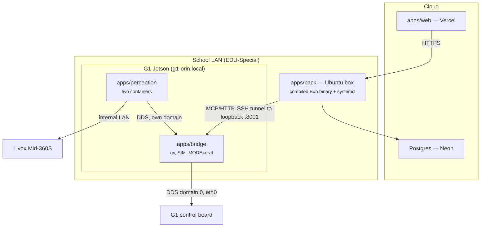

# C3PO — Operations

Where each piece runs, how it deploys, who owns the robot at any moment, and the traps
that have already cost real debugging time. How the system fits together is
`docs/ARCHITECTURE.md`; what the hardware presents is `docs/ROBOT-HARDWARE.md`; the
reverse-engineered control API is `docs/ROBOT-API.md`; why choices were made is
`docs/DECISIONS.md`. Per-app dev docs live in each app's README.

**Standing next to the robot with a session to run?** Start from
`docs/autonomy/test-day/return-checklist.md`: the one dated sheet of what to test
next, in order. `docs/SESSION-CHECKLIST.md` is the general order — deploy, verify,
headset, then motion — and it starts with the deploy step that silently does nothing
if the robot's checkout is on the wrong branch. For the expo stand, run
`docs/DEMO-RUNBOOK.md`. This file is the reference; those are the sequences.

---

## 1. Topology



| Component         | Where                     | How it deploys                                                                   |
| ----------------- | ------------------------- | -------------------------------------------------------------------------------- |
| `apps/web`        | Vercel                    | git push (see `apps/web/README.md`)                                              |
| `apps/back`       | Ubuntu box on the LAN     | `bun build --compile` → one self-contained binary + systemd (§5)                 |
| Postgres          | Neon (managed, sa-east-1) | `drizzle-kit migrate` on deploy (§7)                                             |
| `apps/bridge`     | G1 Jetson                 | `~/c3po` checkout; pushed from the Mac, then `git merge --ff-only incoming` (§5) |
| `apps/perception` | G1 Jetson                 | `c3po perception build`, then `c3po up <stage>`                                  |

Neon is the live DB only; local dev runs against a Homebrew Postgres — setup in
`apps/back/README.md`.

**Why perception cannot move off the robot.** The Livox sits on the robot's _internal_
`192.168.123.0/24` network and the RealSense is USB-attached to the Jetson
(`docs/ROBOT-HARDWARE.md`) — neither is reachable from the school LAN. Even if they were,
that would put a navigation control loop across Wi-Fi. Perception and Nav2 stay onboard;
`back` is the only component that moved off the robot. Why the bridge must be onboard and
why `back` must not be is argued in `docs/ARCHITECTURE.md`.

**Sim topology.** Isaac Sim runs on a separate Ubuntu host, on DDS domain 1. The router
blocks sim-host→Mac UDP across VLANs, so a Mac-hosted bridge cannot receive state from
the sim — drive it from a bridge running locally on that box. Connection values for the
locally spawned sim server live in your local `.mcp.json` (`c3po-sim`) — gitignored, so
each developer writes their own; `apps/bridge/README.md` lists the two entries it needs.

---

## 2. Ports and addressing

The port map, in one place:

| Service                    | Host                    | Port  | Notes                                                                                                                                           |
| -------------------------- | ----------------------- | ----- | ----------------------------------------------------------------------------------------------------------------------------------------------- |
| `apps/back` HTTP           | **loopback** by default | 3000  | cookie auth; `BACK_HOST=0.0.0.0` only on a LAN box behind TLS (§5)                                                                              |
| `apps/web` dev             | dev machine             | 3001  | Vite; open `http://localhost:3001`, never `127.0.0.1:3001` (below)                                                                              |
| `apps/bridge` MCP (daemon) | Jetson, **loopback**    | 8001  | streamable HTTP `/mcp` plus `/camera/*`; unauthenticated — tunnel to it                                                                         |
| `apps/bridge` MCP (child)  | —                       | stdio | when an MCP client spawns it as a child process                                                                                                 |
| `apps/bridge` WS           | Jetson                  | 7077  | **planned, not built** — token must be enforced once off-loopback                                                                               |
| Vision MJPEG               | Jetson, **loopback**    | 8081  | `/live-camera` feed; up with `c3po perception up perception`/`nav2`                                                                             |
| Head camera via videohub   | Jetson, **loopback**    | 8001  | `/camera/*` on the bridge, relayed to browsers by `apps/back` on 3000                                                                           |
| VR teleop                  | Jetson, **LAN**         | 8767  | WebSocket setpoints while `c3po up teleop` is active; `TELEOP_ORIGINS` check, plus a one-use token from `apps/back` when `TELEOP_SECRET` is set |
| Internet proxy             | Mac, **loopback**       | 8899  | `scripts/robot_internet.py`; public :80/:443 only                                                                                               |
| Internet proxy, robot end  | Jetson, **loopback**    | 18899 | the `ssh -R` of that proxy; alive only while the ssh session is                                                                                 |
| Isaac Sim DDS              | Ubuntu sim host         | 7400+ | UDP (CycloneDDS)                                                                                                                                |
| G1 internal DDS            | control board           | 7400+ | multicast, wired internal LAN only                                                                                                              |

`DDS_DOMAIN_ID`: Isaac Sim is `1`, the real G1 is `0` (set per host in `apps/bridge/.env`;
see `apps/bridge/.env.example`).

**On Wi-Fi, address the robot by name, never by IP.** (The cable is different: the
internal `192.168.123.x` addresses are vendor-static, below.) The Jetson is `g1-orin.local` (mDNS,
`avahi-daemon` onboard; SSH user `unitree`, `c3po` Host alias in `~/.ssh/config`). Its
DHCP lease has already moved twice, and one of the old addresses later answered as a
_different device_ — a stale IP does not fail closed, it reaches the wrong machine. Use
the name in `~/.ssh/config`, in `BRIDGE_URL`, everywhere. Lease history, MAC, Wi-Fi
whitelist, and the vendor route trap that black-holes the robot's egress are in
`docs/ROBOT-HARDWARE.md` — the route trap must be re-checked after any Unitree OTA.

The bridge has listened on **loopback only** since 2026-09-06 (`scripts/robot/
c3po-bridge.service` has the reasoning), so `apps/back` reaches it through the tunnel —
`ssh -f -N -o ControlMaster=no -L 8001:127.0.0.1:8001 c3po` — with
`BRIDGE_URL=http://127.0.0.1:8001/mcp` — the default in `apps/back/.env.example` and in
`bun run dev:robot`. Anything still dialling `g1-orin.local:8001` gets a refused connection;
`apps/back` logs the tunnel line when that happens (`unreachableHint`).
`scripts/robot_session.sh [host]` does the whole Mac side in one command (tunnel, robot internet, `bun run dev:robot`, a status table, the robot-side `export`/`c3po up` lines); open the console at `http://localhost:3001`.
The table's `agent` row makes one real model call (`apps/back/scripts/smoke-agent.ts`), so it
can take up to 60 s and needs `AGENT_API_KEY` in `apps/back/.env`. A ✗ there means a wrong
`AGENT_MODEL`, a dead key, a gateway out of reach, or a model that never calls a tool: the
chat would do nothing. Off campus, the TIC AI gateway does not answer.

**Open the console as `http://localhost:3001`, never `http://127.0.0.1:3001`.** Vite
listens on `127.0.0.1` (`apps/web/package.json` `dev`), but the browser must use the name:
`WEB_URL=http://localhost:3001` is `back`'s only CORS origin (`apps/back/src/index.ts`) and
Better Auth's only trusted origin (`apps/back/src/lib/auth.ts`).

**The cable, and keeping the internet.** `c3po-wire` is the Mac's alias for the cabled
path: the Mac at `192.168.123.99/24`, set by hand with no router (the internal LAN has no
DHCP, `docs/ROBOT-HARDWARE.md` §1), and the Jetson at `192.168.123.164`. This worked on
2026-11-03. The `192.168.77.1` address reported on 2026-10-13 is probably the robot's own
Wi-Fi hotspot, not the cable **[?]** (`docs/ROBOT-HARDWARE.md` §1). Joining the robot's own Wi-Fi drops the
school's — a Mac is on one Wi-Fi network at a time — and the robot has no uplink to share.
Use the school Wi-Fi for the internet and the cable for the robot, with **Wi-Fi first in
the service order**: System Settings → Network → "…" → Set Service Order, or

```bash
networksetup -listnetworkserviceorder | head -3      # Wi-Fi must be (1)
sudo networksetup -ordernetworkservices "Wi-Fi" …     # every service, Wi-Fi first
```

Otherwise the cable can win: on the Mac this was written on, all four USB Ethernet
adapters ranked above Wi-Fi, so every connection went down the cable to a robot that
cannot forward it. If the
cable gets no `192.168.123.x` address (a `169.254.x.x` one means it did not), set it by
hand with **no router**, so the cable can never become the default route:
`sudo ipconfig set <enX> MANUAL 192.168.123.99 255.255.255.0` (until unplugged), or the
same values under the adapter's Details → TCP/IP with Router left empty.

On `.99` the Mac sits on the robot's control LAN: DDS domain 0 and the control board's
TCP 9991 (BACKLOG 1.8). **Never turn on Internet Sharing for that adapter.** Route the
cable so it cannot pull: on 2026-11-06 the USB-Ethernet adapter in the Anker hub dropped
three times while the robot walked.

**Lending the robot the Mac's internet.** The robot has no internet on the cable.
`python3 scripts/robot_internet.py unitree@192.168.123.164` runs a proxy on the Mac's
loopback (8899) and an `ssh -R` that shows it on the robot's loopback as
`127.0.0.1:18899`. It reaches only public addresses on ports 80 and 443. For apt and
`c3po perception build`, export the proxy in the robot shell:

```bash
export http_proxy=http://127.0.0.1:18899 https_proxy=http://127.0.0.1:18899 no_proxy=localhost,127.0.0.1,::1
```

`bringup/build.py` (`proxy_build_args`) then builds with `--network host` and the proxy as
build-args. For Gemini, put `https_proxy=http://127.0.0.1:18899` and
`no_proxy=127.0.0.1,localhost` in `apps/bridge/.env`, and **no `http_proxy`**. The bridge
loads that file into `os.environ` (`env_file.py`) and urllib honours it, so an
`http_proxy` there would send the camera relay's `http://127.0.0.1:8081` fetches
(`sdk/camera_relay.py`) to the Mac.

---

## 3. DDS domain map

| Participant                      | Domain     | Why                                                                                                                                   |
| -------------------------------- | ---------- | ------------------------------------------------------------------------------------------------------------------------------------- |
| G1 control board, `ai_odom_node` | 0          | Vendor's, not ours to change                                                                                                          |
| `apps/bridge`                    | 0 (+ ours) | Must be on 0 to reach the control board                                                                                               |
| `apps/perception`                | ours — 42  | Keeps our Nav2/TF/costmaps away from `gemm`'s                                                                                         |
| `gemm` stack                     | 0          | Theirs — incl. `gemm-ai.service`, a live domain-0 participant pinned to `eth0`, not just a port-holder (`docs/ROBOT-HARDWARE.md` §10) |

The bridge spans the boundary — it is the actuation chokepoint (`docs/DECISIONS.md`
D2.1). **It must never subscribe to a bare `/cmd_vel`**: on a shared domain that would
mean another stack's planner driving the robot through our actuation path. Perception
publishes `/c3po/cmd_vel` and the bridge decides what becomes motion.

---

## 4. One owner of the robot

Two independent stacks share the G1 — ours and the colleague's `gemm` workspace. The
sensors have exactly one OS-level owner each, and the control API cannot be
domain-isolated: both stacks must sit on DDS domain 0 to reach the control board at all,
and the firmware arbitrates nothing (every vendor client runs `enableLease=false`). The
invariant is **one commander of the robot at a time**, and it is entirely ours to
enforce. The full rationale, the sensor-ownership facts, and the list of known
other-commander processes live in the `scripts/robot/_common.sh` header; the `gemm`
stack itself is described in `docs/ROBOT-HARDWARE.md`.

### The durable install

There is one installer and one operator command:

```bash
./scripts/robot/c3po install
c3po status
```

The installer links only `c3po` onto `~/.local/bin`, validates and copies one root-owned
systemd unit (never a symlink into the writable checkout), and installs root-owned
logrotate/sudoers policies. It starts nothing. Re-run `c3po install` after merging a unit
change.

| Unit                  | What it owns                                                    |
| --------------------- | --------------------------------------------------------------- |
| `c3po-bridge.service` | The bridge directly (`Type=exec`); no wrapper, nohup or pidfile |

There is deliberately no perception unit and no repair timer. Every perception stage,
including sensor-free ones, is a foreground `c3po up <stage>` decision. Boot may
make `stop_everything` available; it cannot claim a sensor, start Nav2, or arm motion.

**Boot does not require the network.** `bridge_sync`, the unit's `ExecStartPre`, syncs only
when `uv.lock`'s hash changes. A failed sync with a usable venv is a loud warning rather
than a boot refusal; a first install with no interpreter still fails.

### One operator CLI

The implementation remains split into narrow, independently testable operations, but normal
bring-up is profile-based. Operators do not need to remember the order in which the bridge,
perception and teleop layers start or stop:

| Profile                   | What comes up                                                   | Sensor/motion posture                                        |
| ------------------------- | --------------------------------------------------------------- | ------------------------------------------------------------ |
| `c3po up` / `up operator` | Bridge + camera perception + world model                        | Claims RealSense; motion remains gated                       |
| `c3po up core`            | Bridge only                                                     | Claims no sensors; motion remains gated                      |
| `c3po up nav2`            | Bridge + perception + Nav2                                      | Claims RealSense; Nav2 lifecycle and motion gate stay closed |
| `c3po up nav2-fake`       | Bridge + synthetic perception/Nav2                              | Claims no sensors; motion gate stays closed                  |
| `c3po up <stage>`         | Bridge + any named perception stage                             | Claims only the sensors declared by that stage               |
| `c3po up teleop`          | Bridge + camera perception + the explicitly attended VR sidecar | Claims RealSense; teleop's own dead-men still apply          |
| `c3po down`               | Stops teleop, perception, then the bridge                       | Complete C3PO shutdown                                       |

`start` and `stop` remain compatibility aliases for `up core` and `down`.
The granular commands below are retained for diagnostics and partial-stack work:

| Command                                 | Guarantee                                                           |
| --------------------------------------- | ------------------------------------------------------------------- |
| `c3po start`                            | Compatibility alias for `c3po up core`                              |
| `c3po stop`                             | Compatibility alias for `c3po down`                                 |
| `c3po status`                           | Reports bridge, motion gate, perception, teleop and co-tenant state |
| `c3po preflight`                        | Runs the read-only safety gate before Nav2 is armed                 |
| `c3po perception up <stage>`            | Starts one stage and states which shared sensors it claims          |
| `c3po perception stop`                  | Releases perception while leaving the bridge available              |
| `c3po perception build <target>`        | Builds robot-native perception images                               |
| `c3po perception measure <label> [sec]` | Runs the bounded compute harness                                    |
| `c3po gemm {start,stop}`                | Hands ownership to/from the co-tenant                               |
| `c3po teleop {start,stop}`              | Manages only the per-session VR sidecar                             |
| `c3po camera take`                      | Performs the explicit vendor-camera takeover                        |
| `c3po logs`                             | Follows `c3po-bridge.service` in journald                           |

`c3po status` has a `bridge at boot` line. Anything but `enabled` is a problem: the bridge,
and `stop_everything` with it, would be gone after the next reboot. `c3po install` enables
it. `c3po preflight` warns, and does not block, when the person rule is off
(`SAFETY_PERSON_RULE`), when the geofence is off (`SAFETY_GEOFENCE_M` ≤ 0), or when a PARAR
still stands. On the Mac, `./scripts/preflight.sh` says whether the teleop socket wants a
token (§6).

Starting either stack stops the other. The systemd bridge boot path still starts no sensor;
only an explicit `c3po up` profile can compose perception or teleop around it. No profile
arms Nav2 or opens the bridge motion gate.

Bridge logs live in journald. Build/perception trace files are bounded by the installed
logrotate policy; Docker output is bounded per C3PO container with
`max-size=32m,max-file=3` without changing the shared daemon.

**⚠️ `c3po gemm stop` does not stop `gemm-ai.service`.** It is a separate systemd
voice/vision service, verified not to issue motion commands, and owns port 8000. Coordinate
before stopping it. The bridge therefore uses port 8001, on loopback.

**⚠️ `c3po down` (and its `stop` alias) removes `stop_everything`.** Do not stop
the stack mid-task expecting a software cancellation path; the physical e-stop
and firmware velocity deadman remain.

### The PARAR latch and «Reanudar»

Every `stop_everything` writes `~/.c3po/run/stop_everything` (`estop.signal_stop`):
the console PARAR or Shift+Space, both headset grips held 300 ms, the spoken stop, or
a Claude Code tool call. `back` aborts every running agent turn when a PARAR, a
`soft_stop`, a `/tasks` estop or the spoken stop goes through it (`agent/turns.ts`
`abortAllTurns`). A stop that reaches the bridge any other way (headset grips, Claude
Code) ends the turns within about 0.5 s: while a turn runs, `agent/stop-watch.ts` polls
`/safety/status` for a new `stopped_at`. An aborted turn cancels the bridge call it was waiting on, so a
running `walk_to` stops too. Every stop through `back`, and every «Reanudar», also drops the
pending «Confirmar» cards: a card shown before a PARAR cannot run after «Reanudar». Ask again.

The bridge does not need `back` to stop what it is running. A stop that only stamps the
sentinel (the headset's grips, over the teleop socket) is run in the bridge's MCP process
too: it polls the sentinel at 10 Hz and runs `stop_everything` itself, without stamping it
again. So an arm move, a `walk_to` or a Nav2 goal already running there stops even with
`back` down. The bridge log says `stop_everything.foreign_stop`.

While the stop stands, nothing moves:

- the bridge refuses every non-T0 tool except `damp` (`safety.tool_refusal`);
- `_locomotion` zeroes every velocity;
- `arm_sdk` refuses to engage.

**What PARAR sends, and when it damps.** The zero-velocity burst goes first: about 20 zero
setpoints at 50 Hz over 0.4 s. Each one waits for its reply on its own thread, so one slow
reply no longer holds the others. Replies count until 0.3 s after the last setpoint
(`STOP_ACK_GRACE_S`, a guess until the real reply time is measured on the robot). The sport
client is built before the burst starts, so a stop on a client that was never used (its
first Init takes at least 0.7 s) is not lost. Opening the hands and stopping speech start
beside the burst, never ahead of it. Damp follows only when no setpoint was acknowledged or
the burst raised, that is, when the robot never heard the stop (or with
`STOP_EVERYTHING_DAMP=always`). Damp is then retried for at most 4 s. In the result:

- `stop_burst_sent` and `stop_burst_acked`: setpoints sent and acknowledged. One ack is
  enough: no Damp, and the robot stays standing at zero velocity.
- `real_damp_fallback_reason`: `null` when Damp did not run; otherwise
  `burst_unacknowledged`, `burst_failed` or `policy_always`.
- `real_damp_fallback_succeeded`: `true` or `false` when the robot answered the Damp.
  `null` when Damp did not run, or when the 4 s ran out with a Damp still unanswered. That
  last case also sets `real_damp_fallback_unconfirmed: true`: the Damp was sent and may still
  land, so the console judges the stop by telemetry. Only `false` shows as a failed stop.

PARAR also stops the robot's own Spanish speech (`g1_rpc.stop_play`, sent beside the
zero-velocity burst, never ahead of it), and cuts off any utterance still being sent.
Firmware TTS and the co-tenant's speech are out of its reach.

**`soft_stop` ("stop walking")** closes the Nav2 gate, cancels the Nav2 goal and every task
(a `look_around` sweep too), and sends the same zero burst. It never latches and never
damps. `heard: false` in its result means the robot did not acknowledge it: press PARAR.

**The spoken stop: say «emergencia» or «pará, pará».** On synthesised speech they were
heard 13 and 14 times out of 15. A flat «detener» was heard only 7 of 15 times (a
shouted «¡detener!» 14 of 15), and a single «pará», «alto» or «stop» is not a stop
phrase at all. None of this is validated on a stressed human voice yet (pending robot
test).

**Autonomous limits** (`safety.govern`). Only two sources are autonomous: Nav2's cmd_vel
and `go_to_object`'s camera walk. The walk pad, the headset, `turn`, `walk_velocity` and a
`walk_to` called on its own are never limited by these:

- Nav2's cmd_vel: zero unless a world summary ≤ 1 s old says the lidar is online
  (`obstacle_source_stale`);
- `go_to_object`'s camera walk: zero unless a world summary ≤ 1 s old says the detector is
  online (`perception_stale`), whatever `SAFETY_PERSON_RULE` and `SAFETY_STALE_POLICY` say.
  It does not need the lidar: with the Mid-360S faulted it still walks, and it stops within
  about 1 s of the detector going quiet;
- a geofence while the Nav2 gate is open, on both sources: zero velocity further than
  `SAFETY_GEOFENCE_M` (default 3 m; 0 turns it off) from where `arm_navigation` found
  the robot (`outside_geofence`), or with no odometry pose under 1 s old
  (`geofence_pose_unknown`). Renewing an open gate keeps the centre. To recover, drive
  back by hand or re-arm on the spot. `arm_navigation` and `/safety/status` report
  `obstacles_fresh` and `geofence`.

**Walks, one at a time.** `walk_to`, `turn`, `walk_velocity`, `navigate_to` and
`look_around` are walks. `walk_to` (and so `go_to_object`'s camera walk), `turn`,
`look_around` and the Nav2 tools refuse while another walk runs (`walk_task_active`); a new
Nav2 goal still replaces the old one. A `walk_velocity` that moves the robot counts as the
operator's input (the console walk pad, or the headset when it drives through `back`
rather than the teleop stream; decision 11.6b), and it always wins: it cancels a running
`walk_to`, `turn`, `navigate_to` or `look_around`, and waits up to 1 s for it to stop
before its own setpoints go out. When it cancels a `navigate_to`, it first
closes the Nav2 gate (`operator_preempt`): use Nav2 again only after a new
`arm_navigation`. `look_around` runs as a task (its `task_id` is in the reply), so
`cancel_task` or `soft_stop` ends it mid-pause or mid-turn.

**When a walk refuses or stops** (the phase is in the task result):

- `fsm_not_walkable` (`walk_to`, `turn`, `walk_velocity`): an FSM reading under 5 s old is
  outside 500/501, for example 802 after R2+A (§5). An unknown or stale reading does not
  refuse.
- `arm_held` (every walk; the reason `arm_held` for the Nav2 tools): this bridge holds the
  arms on `rt/arm_sdk` (`move_arm` with `hold`, `pick`, `reach`), and walking under arm_sdk
  weight is untried. Call `release_arm_control` first.
- `pose_stale` (`walk_to`, `turn`): the odometry pose is over 1 s old, at the start or
  mid-walk. The walk stops instead of going on toward a target it can no longer measure.

A `walk_velocity` of zero is a stop, and none of these refuses it.

The latch survives bridge and teleop restarts. Only «Reanudar» clears it. It is admin
only, from the console's «PARAR ACTIVO» chip or the headset menu. `back`'s
`POST /safety/ack` forwards it to the bridge's `/safety/ack` with
`SAFETY_CONFIRM_SECRET`, and a stop newer than the one the operator saw gets 409
`newer_stop`. Re-engaging the headset does not clear it (993da12). With no secret
configured in both `.env` files, nothing clears it: set the secret, restart `back` and
the bridge, then «Reanudar».

### When a pick or place refuses

A `pick` or `place` that cannot plan moves nothing. Its task ends `failed` in phase
`planning`, with the English reason in `error` and three more fields in `result` (dbf876c):

- `reason`: `table_clearance`, `torso_clearance`, `surface_clearance`, `branch_flip`,
  `joint_limits`, `out_of_reach` or `workspace`;
- `advice`: how far to walk (`step_forward_m`, `step_back_m`, `step_left_m`,
  `step_right_m`, in metres), or a `problem` walking cannot fix (`too_low`, `too_high`,
  `behind_table_edge`, `table_clearance`, `look_again`);
- `note`: the same in short Spanish, which the console shows under «Falló», for example
  «Acercate ~0.05 m y correte ~0.14 m a la izquierda, después mirá de nuevo.» or «La mano
  tocaría la mesa: el objeto es muy bajo para agarrarlo. Caminar no lo arregla.»

When perception reports the table under the object (`support`, below), the planner keeps
every arm link 1 cm clear of it, and forward advice keeps the table edge at least 0.25 m
from the torso (`WALK_EDGE_STANDOFF_M`, e346c31). The hand still passes 8 cm over the
object itself: a report can never lower it. Without a report the old rule stands: keep the
desk edge at least 0.24 m in front of the torso.

A pick curls the hand (`power`, 0.8 s) before the arm moves and opens it only at the
10 cm pre-grasp (1439ace). From there on the table check models the open hand: 9 cm past
the tool point to the fingertips and 4 cm wide (`FINGER_M`, `HAND_OPEN_RADIUS_M`). Both are
guesses until the BrainCo Revo2 is measured. Until then most tabletop picks refuse with
`table_clearance`: in the simulator's random table scenes only 1 in 20 (3 in 200) plan, and
those objects sit at least 10 cm above the top. A phone or a wallet lying flat always
refuses. A pick that starts with something already in the hand drops it when the hand
opens at pre-grasp. A place withdraws until the palm is behind the reported edge before it
releases the arm, and refuses with `table_clearance` when the edge is too close for that
(about 0.2 m or nearer). The planner takes the table's front edge as square to the robot,
so an edge seen at an angle is nearer on one side: stand square to the table. `pick` and `place` still refuse on the robot unless `C3PO_ALLOW_PICK=1`
(§6).

**The table under each object.** The vision container fits the surface under the nearest
four non-person detections and adds `support` to each: `z_m` (the top's highest point
between its near end and the object, in base_link, the pelvis; negative below it),
`near_edge_m` (the range of the nearest edge along the object's bearing; `null` when the
edge is out of view or something over the table, such as a hand, hides its near part),
`inliers`, `rms_m`, `stamp_unix` (4d3b662), and `cam_top_xyz` / `cam_near_xyz`: the top
under the object and at its near end, in the camera optical frame (58ac1d0). The bridge
puts those two through the same camera mount as the object (e346c31), so a `C3PO_CAMERA_*`
override on the vision side cannot put the table and the object in different frames.
Without them it falls back to `z_m` and `near_edge_m`. The planner uses a support only when it comes from the
same frame as the object.
`C3PO_VISION_SUPPORT=0` in `~/.c3po/perception.env` turns it off at the next `c3po up`; the
planner then falls back to the old rule. The vision image must be rebuilt once for it
(`c3po perception build vision`).

### The operator face gate

Off unless `C3PO_FACE_GATE` is set (17cf24a). Each gated skill then also needs the
enrolled operator's face, live, in front of the head camera. It is one more gate on top of
the login and «Confirmar», never instead of them. It runs after every other check (PARAR,
battery, the person rule, the confirmation), for every caller: the console, the agent and
Claude Code. Stops and releases (`stop_everything`, `soft_stop`, `damp`, `release_arm`,
`release_arm_control`, `open_hands`, `cancel_task`, `cancel_navigation`,
`disarm_navigation`) are never gated, whatever the list says.

Setup, once per robot and operator:

1. Rebuild the vision image from this branch and bring perception up
   (`c3po perception build vision`, then `c3po up`). The gate reads the vision container's
   camera and its `/depth_points` (3ec5e99), so the vision container must hold the camera.
   If videohub holds it, or the image is older than `/depth_points`, every gated call
   refuses with `operator_face_check_unavailable`.
2. On the robot, with the proxy exported as for the builds:
   `bash ~/c3po/apps/bridge/scripts/install_face_models.sh`. It fetches YuNet and SFace from
   opencv_zoo, pinned by commit and sha256, into `~/.c3po/face/models`, and ends with
   `OK — models in …`. Re-running only fetches what is missing or wrong.
3. Enroll, on the robot, with the operator alone in front of the head camera, within
   1.2 m: `cd ~/c3po/apps/bridge && .venv/bin/python scripts/face_enroll.py`. The operator
   reads the consent text and answers `s`. It needs 5 frames with exactly one live face,
   all of the same person, and ends with `enrolled: …/operator.npy`. Re-running replaces
   the operator; `--delete` forgets them. An interrupted run leaves
   `~/.c3po/face/.operator.npy.tmp`, and saving refuses until `--delete` removes it.
4. In `apps/bridge/.env`: `C3PO_FACE_GATE=confirm`. Restart the bridge (`c3po restart`).
   `c3po logs` shows `face_gate.on` with the gated tools and `max_m`.

`confirm` is a class: every tool that needs «Confirmar» (T2, and high-danger T1). Use it
rather than a list of names: with only `pick` gated, `move_arm` and `set_hand` could do
the same work without a face. Tool names can be added after it, comma-separated. A name
that is no tool does not stop the bridge: it is dropped, the gate widens to `confirm`, and
`c3po logs` shows the error `face_gate.unknown_names` with that entry (371dd0b).

Settings, in `apps/bridge/.env`, read when the bridge starts:

| Key                    | Default        | Meaning                                 |
| ---------------------- | -------------- | --------------------------------------- |
| `C3PO_FACE_GATE`       | empty (off)    | `confirm` and/or tool names, comma list |
| `C3PO_FACE_GATE_MAX_M` | `1.2`          | a face farther than this does not count |
| `C3PO_FACE_DIR`        | `~/.c3po/face` | models and the enrollment (owner-only)  |

**What counts as a live face.** YuNet finds it and SFace matches it against the enrolled
vectors (cosine 0.363). Then the bridge asks the vision container for the depth at YuNet's
five landmarks (eyes, nose, mouth corners) in the same frame (`/depth_points`) and turns
them into 3-D points. The nose must stand at least 1.5 cm in front of the plane through the
eyes and mouth corners (`MIN_NOSE_M`), whatever the tilt of that plane, so a print or a
screen fails flat or tilted (cc17f68). The face must also be 0.11–0.20 m wide at its
distance, within `C3PO_FACE_GATE_MAX_M`. It is not anti-spoofing: a mask, or a print bent
sharply around the nose, still passes. The 1.5 cm is not yet measured on the robot's D435.
The check gives up after 1.5 s and refuses on any failure, or at once while another check
is still running. It runs on its own thread, off the event loop, so a PARAR is never held
up by it.

**The headset cannot pass it.** It covers the face. To run a gated skill, the operator
stands at the robot without the headset, faces the head camera and retries.

**What the operator sees when it refuses.** Nothing moves. In chat the console shows an
amber «Rechazado» card with one of these hints; a skill invoked from the console shows the
hint as its result:

| Bridge reason                     | Console says                                                                                                                      | Do                                                                                                              |
| --------------------------------- | --------------------------------------------------------------------------------------------------------------------------------- | --------------------------------------------------------------------------------------------------------------- |
| `operator_face_not_seen`          | «No veo al operador: parate junto al robot, sin el visor, de frente y cerca de la cámara de la cabeza, y reintentá»               | Stand at the robot without the headset, face the head camera and retry once. Only the enrolled operator counts. |
| `operator_face_not_live`          | «Reconocí al operador, pero no en persona (¿foto, pantalla o muy lejos?): parate junto al robot, cerca de la cámara de la cabeza» | The face was matched but was too far, had no depth, or looked flat or the wrong size. Stand closer, in person.  |
| `operator_face_not_enrolled`      | «No hay operador registrado: corré face_enroll.py en el robot»                                                                    | Enroll (step 3). An enrollment file others can read or write is ignored, too.                                   |
| `operator_face_check_unavailable` | «No se pudo verificar la cara del operador (¿contenedor de visión o modelos?)»                                                    | Check the vision container is up and holds the camera, and the models are installed. Do not retry in a loop.    |

A refusal carries only the reason code and a fixed hint. The measurements (distance,
width, nose margin) go only to the bridge log: `c3po logs | grep face_gate` gives them and
how long each check took (`ms`). The console names the head camera, not a distance
(a80cc7e). A face refusal does not spend the «Confirmar»: retry within its 30 s and no new
confirmation is needed. After 30 s, confirm again.

**Privacy.** Only SFace feature vectors are stored, in `~/.c3po/face/operator.npy` on the
robot (file 0600, directory 0700). No image is kept, nothing leaves the robot, and neither
faces nor feature vectors are logged. The bridge ignores an enrollment that is a symlink,
belongs to another user, can be read or written by others, or holds a NaN or zero row.
`face_enroll.py --delete` removes the operator.

**To turn it off**, at the stand or anywhere: `C3PO_FACE_GATE=` (empty), then
`c3po restart`.

---

## 5. Per-component deploy

### `apps/web` → Vercel

Push to deploy. Env: see `apps/web/.env.example` (`BETTER_AUTH_SECRET` must match
`back`). Runtime and adapter constraints are in `apps/web/README.md`.

Since `back` sits on a private LAN, the console only works where that box is reachable —
fine for on-site use; exposing `back` publicly is a deliberate decision, never a side
effect.

### `apps/back` → Ubuntu LAN box

Builds to a single self-contained binary — no `node_modules` at runtime:

```bash
bun run build                      # → ./server
scp apps/back/server ubuntu-box:/opt/c3po/server.new
bunx drizzle-kit migrate           # migrate FIRST — deploy order matters (§7)
mv server.new server && systemctl restart c3po-back
```

Keep the previous binary alongside for rollback. Env: see `apps/back/.env.example` — it
is the authority for every variable, including the TIC AI gateway gotchas (HTTPS only —
port 80 is blocked from the Wi-Fi VLAN — ORT-network-only, hand-issued keys). Three things
to verify per deploy target:

- **Set `BACK_HOST=0.0.0.0` in the box's env.** `back` binds `127.0.0.1` by default, so
  without it the binary boots, `/health` answers on the box itself, and every remote
  console gets connection refused. Only do this behind TLS. Check with
  `ss -ltnp | grep 3000` (expect `0.0.0.0:3000`; on a dev machine expect `127.0.0.1:3000`).

- **The box must have a route to the TIC AI gateway.** Without one, `back` boots and
  serves `/health`, `/skills`, `/state` — and fails every `/agent` call. This rules out
  Vercel for `back` and is a thing to _test_ on the LAN box, not assume. Gateway outages
  also happen; expect `/agent` to be down while the rest of `back` is fine — a 2026-08-18
  nginx 502 stretch surfaced to the operator as _"Failed after 3 attempts. Last error:
  Bad Gateway"_ after ~6 s (the AI SDK retries a 5xx twice; the HTML body never leaves
  `APICallError.responseBody`).
- **The three AI SDK packages move as a set**: `ai` + `@ai-sdk/openai-compatible` in
  `back`, `ai` + `@ai-sdk/svelte` in `web`. Their major numbers differ by design
  (currently majors 7 / 3 / 5 — exact pins in `apps/back/package.json` and
  `apps/web/package.json`), each carrying a provider-specification version. `ai@7`
  speaks spec v4 and refuses a v3 model with `UnsupportedModelVersionError` **on the
  first request only** — a mismatch typechecks and links, so CI (type-check only)
  passes it and `bun build --compile` freezes it into the shipped binary. Bump all
  three in one change and exercise one real `/agent` turn before shipping. npm
  publishes `ai-v6`/`ai-v5` dist-tags on all three if a line must be walked back.

**Sign-in is rate limited**, per client address: Better Auth's default for sign-in is 3
tries in 10 s, then 429, which the login page shows as «Demasiados intentos. Esperá un
momento y probá de nuevo.». `/get-session` is exempt, and PARAR never goes through the
limiter. The address is the TCP peer: `lib/auth-plugin.ts` overwrites `X-Forwarded-For`
with it, because any client can write that header. That is right while browsers reach
`back` directly. **A TLS proxy in front of `back`** would make every browser one address,
so one bucket, and one person could lock everyone out: the plugin would then have to keep
the proxy's `X-Forwarded-For`, and `advanced.ipAddress.trustedProxies` would have to list
the proxy. There is no sign-up page: accounts are made
from `apps/back` with `bun scripts/create-user.ts <email> <name> [--admin]`.

### `apps/bridge` → G1 Jetson

A git checkout at `~/c3po`; Python and `uv` under `~/.local`; CycloneDDS prebuilt on the
box (paths in `apps/bridge/.env.example`). Deploy by pushing from the Mac: the robot has
no internet on the cable, so it cannot fetch from GitHub.

```bash
# On the Mac:
git push ssh://unitree@192.168.123.164/home/unitree/c3po feat/autonomy:refs/heads/incoming
# On the robot (ssh -t, in your own terminal: install asks for the sudo password):
cd ~/c3po && git merge --ff-only incoming && ./scripts/robot/c3po install && c3po restart
```

`--ff-only` refuses a robot checkout that has diverged. Then stop and look: never force,
and never touch `~/gemm*`. `c3po install` stages and validates root-owned files, so it
needs the `unitree` sudo password; run it in the operator's own terminal (`ssh -t`),
because Claude Code cannot type it. `c3po restart`, `c3po up core` and `c3po down` need no
password: `/etc/sudoers.d/c3po` (from `scripts/robot/c3po.sudoers`, installed 2026-11-06)
grants exactly `systemctl {start,stop,restart} c3po-bridge.service`, plus the two camera
commands `systemctl stop master_service` and `pkill -9 -x videohub_pc4`. Every other sudo
command still needs `ssh -t` and the password.

**After the autonomy PRs merge** (#7 → #8 → #9 into `integrate/october`, then #3 into
`main`), keep deploying `feat/autonomy`. On the Mac, bring `main` into it first, then push as
above:

```bash
git fetch origin && git switch feat/autonomy && git merge origin/main
# run the tests, then the push above
```

Never push `main` to the robot. If the PRs land as a squash or a rebase, `main` does not
contain the commits the robot runs, so `git merge --ff-only incoming` refuses, and the only
way past that is a force, which this section forbids.

Re-running the installer is intentional: unit and root-owned config changes are applied
and validated in the same operation. `c3po restart` restarts only the bridge; perception
containers are untouched. `bridge_sync` handles dependency changes and re-applies the SDK
patch before the service starts. Config remains in `apps/bridge/.env`.

- **⚠️ Restart is a brief `stop_everything` outage.** Deploy only with the robot stopped
  and the physical e-stop available.
- **Transport trap.** The bridge defaults to stdio for child-process MCP use. The systemd
  unit pins daemon mode to HTTP on `127.0.0.1:8001`, the same loopback bind ad-hoc
  developer runs default to.
- **8001 is loopback-only; 8767 is not.** Port 8001 has no transport authentication and
  can invoke robot tools, so since 2026-09-06 it is reached only through the SSH tunnel
  (§2) — `apps/back` and anything else off the robot dial `127.0.0.1:8001` on their own
  end of `-L 8001:127.0.0.1:8001`. Port 8767 still accepts live teleop setpoints from the
  LAN while `c3po up teleop` runs, and the robot has no active host firewall: use
  `g1-orin.local`, never a stale DHCP address, and treat the school LAN as part of the
  robot's control boundary for as long as teleop is up.
- **Non-interactive SSH PATH trap.** `~/.local/bin` comes from `~/.profile`; use
  `ssh c3po 'bash -lc "c3po status"'` or the script's absolute path. The unit has an
  explicit `PATH` and does not depend on a login shell.
- **Boot unit.** `c3po install` installs and enables `c3po-bridge.service`. The unit
  directly supervises the interpreter, claims no sensor, and issues no motion command.
- **What was deployed.** `c3po install` (since 31b2d64) writes `~/.c3po/deployed` as
  `<sha> <UTC time>`. When the commit changes, the one it replaces goes to
  `~/.c3po/previous-deploy` as a bare sha, and the loaded unit goes to
  `/var/lib/c3po/previous-c3po-bridge.service` (with `~/.c3po/unit-backup-for` naming the
  commit that copy was taken for). Re-installing the same commit changes none of them. The
  rollback below reads them.
- **The first call after `c3po restart`.** The bridge answers `back`'s old MCP session
  with 404, and `back` now sends that call once more on a fresh session. So a PARAR right
  after a restart goes out instead of showing «La orden de parada no salió».
- **Root boundary.** Unit files are copied root-owned into `/etc/systemd/system`; PID 1
  never follows a symlink into the user-writable checkout. A merge does not update a loaded
  unit until `c3po install` validates, copies and reloads it.

**Rollback.** This is the one recipe; the runbooks point here. Pushing an older commit does
not work: git refuses it as a non-fast-forward on `incoming`, and `git merge --ff-only` with
an older commit only says "Already up to date". The robot already has every commit it ran,
and `c3po install` records the one it deployed before, so roll back on the robot itself:

```bash
# On the robot (ssh -t: install asks for the sudo password):
cd ~/c3po
git status --short                     # must print nothing; stop if it does
cat ~/.c3po/deployed                   # runs now: "<sha> <UTC time>"
cat ~/.c3po/previous-deploy            # ran before it: a bare sha
git checkout --detach "$(cat ~/.c3po/previous-deploy)"
./scripts/robot/c3po install && c3po restart
cat ~/.c3po/deployed                   # must now name the commit you checked out
```

No `~/.c3po/previous-deploy` means only one install has been recorded so far (the first with
this installer, 31b2d64). Then take the commit from `git reflog -5` (`HEAD@{1}` is usually
the one before the last merge) and check that out instead. Never check out a commit older
than be8001b (2026-08-22): its installer is the old full-stack one and would revive the
retired perception unit and repair timer. `git merge-base --is-ancestor be8001b <sha>`
must succeed. After a rollback, `previous-deploy` names the commit you left.

If the last `cat ~/.c3po/deployed` still names the newer commit (an installer older than
31b2d64 records nothing), record the one now running, so the next install keeps the right
unit:

```bash
printf '%s %s\n' "$(git rev-parse HEAD)" "$(date -u +%Y-%m-%dT%H:%M:%SZ)" > ~/.c3po/deployed
rm -f ~/.c3po/unit-backup-for
```

The checkout is now detached, and its branch still points at the newer commit. To go
forward again, push the fix to `incoming` as above, then on the robot:

```bash
cd ~/c3po && git checkout - && git status -sb   # back on the branch; check its name
git merge --ff-only incoming && ./scripts/robot/c3po install && c3po restart
```

**The unit backup.** Each install that moves to a new commit first copies the loaded unit
to the root-owned `/var/lib/c3po/previous-c3po-bridge.service`, and writes that new commit
to `~/.c3po/unit-backup-for`. Installing the same commit again, or retrying an install that
failed half way, keeps the copy. So while `unit-backup-for` names the commit in
`deployed`, the copy is the unit that ran the commit in `previous-deploy`. `c3po install`
from the older checkout installs that checkout's own unit, so the copy is needed only when
that install fails: the older code must not run under the newer unit. This restores it
only when the check holds:

```bash
if [ "$(cat ~/.c3po/unit-backup-for)" = "$(cut -d' ' -f1 ~/.c3po/deployed)" ]; then
  sudo install -o root -g root -m 0644 \
    /var/lib/c3po/previous-c3po-bridge.service \
    /etc/systemd/system/c3po-bridge.service
  sudo systemctl daemon-reload && sudo systemctl restart c3po-bridge.service
else
  echo "the copy is the newer unit: not restored"
fi
```

"Not restored" means the failed install got as far as replacing the copy with the newer
unit: stop and look. After a restore, record the running commit with the two lines above.

A rollback leaves the perception images as they are. `c3po perception build` on the
older checkout rebuilds them, if the rollback is about perception code.

### When the robot ignores everything

Symptom: every posture and locomotion command returns **rpc_code 0** and the
robot does not move. `get_state` reports `posture="unknown"` and `fsm_id=None`,
and the bridge log fills with `rpc_code=3102` from the FSM poller.

This is almost never a network fault, and it looks exactly like one — we
checked cables, `DDS_INTERFACE`, `ROBOT_HOST` and the peer config before
finding it on 2026-08-20. The robot has **no motion controller loaded**. The
colleague's `xr_teleoperate` calls `Enter_Debug_Mode()`, which loops
`ReleaseMode()` until nothing is loaded, and that state lives in the robot — so
killing their processes does not undo it, and neither does restarting ours.

Diagnose and fix, in that order:

```bash
cd ~/c3po/apps/bridge && set -a && . ./.env && set +a
uv run python scripts/select_motion_mode.py --check-only   # empty name = this
uv run python scripts/select_motion_mode.py                # robot supported!
```

`check_motion_mode` is the diagnostic that distinguishes this from a wrong FSM
id, because both answer `code 0` from the sport service and look identical
otherwise. Expect to need this **once per session** whenever the robot is
shared.

### Accepts velocity, does not move: FSM 802

R2+A on the remote puts the robot in 802 (Run, `docs/ROBOT-API.md` §4.1). In 802,
`SetVelocity` answers rpc 0 and nothing moves (unitree_sdk2_python #170, BACKLOG §12).
Bring-up must end in **501**: the bring-up panel's «1 · Amortiguar → 2 · Preparar →
3 · Habilitar marcha» is `damp` → `prepare` → `start_walking_waist`. Read `get_state`
`fsm_id` after every `SetFsmId`, because rpc 0 proves nothing (`docs/ROBOT-API.md` §12:
`SetFsmId(99999)` also answers 0).

Since d8de62f the bridge refuses the walk instead of standing still for its whole timeout:
`walk_to`, `turn` and a moving `walk_velocity` end with phase `fsm_not_walkable` while a
fresh FSM reading is outside 500/501 (§4, "Walks, one at a time"). The headset's walk pad
warns in 802 too. A gesture still runs from 802.

### Putting a Quest on the console

WebXR refuses `immersive-vr` outside a **secure context**, so browsing the headset
to `http://<mac-ip>:3001` gives a page where `navigator.xr` is simply undefined —
/vr-control reports "WebXR no está disponible" with nothing visibly wrong. HTTPS
with a self-signed cert works but means clicking through a certificate warning
inside a headset, per port.

`http://localhost` **is** a secure context (a potentially trustworthy origin, and
Quest Browser is Chromium), so the answer is USB: `scripts/quest_setup.sh` uses
`adb reverse` to forward the headset's own localhost to this machine. The page
becomes secure-context, `ws://localhost:8767` is same-scheme so there is no
mixed-content problem, and nothing is exposed to the school LAN — a bonus, given
the teleop socket has no authentication of its own.

The script verifies every port is listening **before** forwarding, because a
forward to a dead port succeeds now and fails later, in the headset, as a page
that will not load. Needs `adb` (`brew install --cask android-platform-tools`),
developer mode on the headset, and the in-headset "Allow USB debugging?" prompt
accepted — that last one is easy to miss.

✅ **First run against a real Quest: 2026-08-21.** Detection, authorisation, the
port checks and all four forwards work, and the Quest browser loads the console
over `http://localhost:3001` — the secure-context reasoning holds. Two bugs
surfaced and were fixed on that run: Vite bound `::1` only while `adb reverse`
connects over IPv4 (fixed with `--host 127.0.0.1` in `apps/web/package.json`),
and the script's own empty-tunnel check was silently defeated by `pipefail`,
awarding a dead camera port a green tick — the exact failure its header promises
to prevent, reintroduced by the shape of the fix for it.

⚠️ **Still unproven: that an immersive session drives the robot.** On the first
run no teleop session ever registered — `list_active_tasks` stayed empty, because
8767 was not forwarded at the time. Head yaw reaching the robot from a headset
has not been observed end to end, and the yaw sign is still unsettled.

🔧 **The camera port is read from `PUBLIC_ROBOT_CAM_URL`, not hardcoded — since
2026-08-27.** The forward list said 8081, which is `apps/perception`'s vision
container. The feed had already moved to **8001**, the bridge's own port (see
"WHY NOT PORT 8081" in `mcp_server.py`: 8081 belongs to the process that is dead
in exactly the case the relay exists for). `PUBLIC_ROBOT_CAM_URL` was updated;
the forward list was not, so the headset asked _its own_ `127.0.0.1:8001`, where
nothing listens.

The symptom was "i cannot see the camara" with **everything else working** —
because everything else reaches the bridge through apps/back on 3000, which was
forwarded. `quest_setup.sh` now parses the port out of `apps/web/.env` (falling
back to `.env.example`), so the two cannot drift apart again. If you point
`PUBLIC_ROBOT_CAM_URL` somewhere new, the forward follows it with no edit here.

The headset also no longer goes silently black when the feed is missing: the
camera layer draws a **SIN IMAGEN** card naming the reason, the same way the
radar dial always says why it is empty. A black field is an assertion that
everything is fine, and it was wrong every time it appeared.

🚨 **THE BRIDGE IS NOT ON LOOPBACK. It is on `0.0.0.0`, on the school LAN.**
Verified on the running robot, 2026-08-28:

```
$ ss -ltnp | grep 8001
LISTEN 0 2048 0.0.0.0:8001 0.0.0.0:*  users:(("python",pid=1213,...))
$ hostname -I
192.168.123.164  172.17.0.1  10.10.32.19      # <- 10.10.32.19 is the school LAN
```

`scripts/robot/c3po-bridge.service` **used to set** `Environment=BRIDGE_HOST=0.0.0.0`,
while `apps/bridge/.env.example` said `127.0.0.1`, the code default was
`127.0.0.1`, and the table above and `apps/back/src/routes/telemetry.ts` both
said **loopback**. Four places described this port and the one that actually ran
disagreed with the other three.

The consequence: `http://10.10.32.19:8001/mcp` was reachable from anywhere on
the school Wi-Fi, and it is the tool surface that can **walk the robot**, with
no authentication of its own. The SSH-tunnel posture that everything else in
this document assumes was not what was deployed. It arrived with the unit taken
from `main` in `06e5ea9` (2026-08-26).

✅ **Decided 2026-09-06: the unit binds `127.0.0.1`.** The alternative was to
keep the LAN binding and write down that we meant it, and that loses on the
merits — an unauthenticated API that can walk a humanoid should not be
reachable from a shared school Wi-Fi, the tunnel already exists and is already
printed by `quest_setup.sh`, and every other place in the repo already said
loopback. Keeping it would have meant editing five correct files to match one
wrong one.

**This breaks any back-end dialling the robot's LAN address**, which is not
hypothetical: a local `apps/back/.env` carrying
`BRIDGE_URL=http://10.10.32.19:8001/mcp` will now get a refused connection —
`bridge_unavailable` against a bridge that is perfectly healthy, the same
symptom the 8000/8001 port confusion produces. Two things to do, in this order:

```bash
ssh -N -L 8001:127.0.0.1:8001 -o ControlMaster=no c3po   # keep this running
# then in apps/back/.env:
BRIDGE_URL=http://127.0.0.1:8001/mcp
```

`apps/back` prints that exact pair of lines to its log the first time a connect
fails while `BRIDGE_URL` names a non-loopback host, so the breakage explains
itself rather than presenting as a dead robot.

**The tunnel was already mandatory, which is what makes this cheap.** `/camera/*`
and `/mcp` are `@mcp.custom_route`s on the _same_ FastMCP server — one process,
one port. A working headset setup already forwarded 8001, because
`apps/web/.env.example` then reached the camera at `http://127.0.0.1:8001/camera`
and `quest_setup.sh` printed the `-L 8001:127.0.0.1:8001` line for exactly that
reason. (Both have since moved: the camera now goes through `apps/back` on 3000 —
`PUBLIC_ROBOT_CAM_URL=http://localhost:3000/camera`, below.) So the LAN binding
was never buying access that the tunnel did not already provide — the console's two halves had simply drifted into disagreeing
about how to reach one port on one process, with `apps/web` going through the
tunnel and `apps/back` going around it. Pointing `BRIDGE_URL` at
`127.0.0.1:8001` needs no new forward.

⚠️ **A robot keeps binding `0.0.0.0` until it is redeployed.** The unit file is
what changed, and `/etc/systemd/system/c3po-bridge.service` is a root-owned
**copy**, not a symlink into the checkout: a new checkout alone changes nothing
systemd runs, and only `c3po install` validates, copies and reloads the new unit
(§4, "The durable install"). The checkout also has to have the change, and on a
branch without it the install faithfully re-copies `0.0.0.0`. Check with
`git -C ~/c3po log --oneline -1 -- scripts/robot/c3po-bridge.service` before
concluding anything. Then, after the push above:

```bash
git -C ~/c3po merge --ff-only incoming
grep BRIDGE_HOST ~/c3po/scripts/robot/c3po-bridge.service   # must say 127.0.0.1
~/c3po/scripts/robot/c3po install && c3po restart
grep BRIDGE_HOST /etc/systemd/system/c3po-bridge.service    # the copy systemd runs
ss -ltnp | grep 8001                                        # must NOT say 0.0.0.0
```

Until that lands, `c3po status` keeps reporting the wildcard bind as a problem,
which is correct — it reads the socket, not this file.

🔧 **`BRIDGE_CORS_ORIGINS` was set in the unit and read by no code.** The same
file carries
`Environment=BRIDGE_CORS_ORIGINS=http://localhost:3001,http://127.0.0.1:3001`,
and `grep -rn BRIDGE_CORS_ORIGINS ~/c3po/apps/` on the robot returned nothing.
Somebody decided the CORS policy, wrote it into the deployment, and it was
never implemented — which is why `/camera/status` answered 200 with no
`access-control-allow-origin` and the headset's camera could not have loaded.
The bridge now reads it, applied to `/camera/*` only.

✅ **The header plumbing is verified ON THE ROBOT** (2026-08-28), without
disturbing the running stack: this branch was checked out into a throwaway
worktree and started in `SIM_MODE=stub` on loopback:8009, which creates no DDS
participant (`mcp_server.py`'s `if SIM_MODE != "stub"` guard), claims no
sensor and commands nothing. Results:

| request                         | response                                                              |
| ------------------------------- | --------------------------------------------------------------------- |
| `Origin: http://localhost:3001` | `access-control-allow-origin: http://localhost:3001` + `vary: Origin` |
| `Origin: https://evil.example`  | no CORS header                                                        |
| no `Origin` (apps/back, curl)   | no CORS header — correct, CORS is browser-only                        |

The 503 (stub mode has no camera) **carries the header**, which was the point:
the console can read the _reason_. `Vary` is not needed on the no-CORS replies
because every camera response is `Cache-Control: no-store`, so nothing caches
them. The process was killed by pid and the worktree removed; the robot's
checkout stayed on `152e3a6`.

What remains unverified is the picture in the headset, which needs the bridge
restarted onto this branch.

🔧 **The camera now reaches the browser through `apps/back`, not port 8001.**
8001 is the bridge, which also serves `/mcp` — the tool surface that can walk
the robot, unauthenticated. `quest_setup.sh` used to forward it into the Quest's
browser for the picture, protected only by a test keeping CORS off `/mcp`.

`apps/back/src/routes/camera.ts` now relays `/camera/status` and
`/camera/stream.mjpg` behind Better Auth, on 3000 — already forwarded, and the
same path `/telemetry/*` and `/map/costmap.png` take.
`PUBLIC_ROBOT_CAM_URL=http://localhost:3000/camera`; the console sends its
session cookie (`credentials: "include"`, `crossOrigin="use-credentials"`), and
`quest_setup.sh` forwards nothing extra. The stream proxy times out only on
connect, never on a live stream, and closing the viewer closes the upstream
request (`camera.test.ts`), so reconnects do not pile up streams in the tunnel.

The bridge keeps its `/camera/*` CORS grant for direct debugging. **Unverified
with the headset on**, like the rest of this section; the first check is that
`/vr-control` shows a picture with no forward on 8001.

### Deploying this branch to the robot, then closing it out 🔧

Nothing in the headset can be judged until the robot runs the branch under test.

```bash
# 0. Session start: gemm's containers must not be up (they hold the D435).
ssh c3po 'docker ps'
# 1. Robot free? Nobody else driving? (OPERATIONS §4 — one commander.)
#    Push and merge as in "apps/bridge → G1 Jetson" above, then:
ssh c3po 'systemctl is-active c3po-bridge'

# 2. Prove the fix landed, from the Mac, before the headset goes on:
ssh c3po 'curl -sD- -o /dev/null -H "Origin: http://localhost:3001" \
    http://127.0.0.1:8001/camera/status | grep -i access-control'
#    expect:  access-control-allow-origin: http://localhost:3001
#    nothing => the restart did not take the new code. Stop here.

# 3. Then the headset.
scripts/quest_setup.sh
cd apps/bridge && uv run python scripts/headset_check.py
```

`c3po-bridge.service` says "does not claim sensors at boot", so the restart in
step 1 does not take the camera or the LiDAR from anyone — but it is still a
restart of a shared machine's service, so ask first.

Step 2 is not optional and is the lesson of 2026-08-27/28: the port fix and the
CORS fix are two separate causes of one identical black view, and testing the
second while running a build that has neither is how you conclude a correct fix
did not work. `preflight` now runs this check itself and says so in plain
language when frames arrive but the console cannot read them.

### Closing out the headset session — `headset_check.py` 🔧

Everything the headset does is currently **unverified**: immersive mode, the
panel position, the readiness banner, joystick walking, the 8-second alert
band, the lidar radar, the camera picture, and the per-eye stereo fix. Eight
changes across four days, none of them worn.

```bash
scripts/quest_setup.sh                                     # forward the ports
ssh -N -L 8001:127.0.0.1:8001 -o ControlMaster=no c3po     # another terminal
cd apps/bridge && uv run python scripts/headset_check.py
```

It prompts for each one with what to look for, and prints a report that can be
pasted into the commit that flips a claim from unverified to verified.

**The part that is not a checklist:** every visual check that depends on data
asks the bridge FIRST, and a NO with no data behind it is recorded **BLOCKED**,
never FAIL.

That distinction is the entire point. "I cannot see the radar" and "I cannot
see the camera" were reported three times between 21 and 27 August and the
cause was different every time — a clip-space placement outside the lens cone,
a QoS mismatch that meant no ring was ever published, and a port the headset
never had forwarded. **Two of those three were not rendering bugs**, and from
inside the headset all three looked identical. A FAIL from this script means
"the data was there and the headset did not show it", which is worth acting on.
A BLOCKED means go and start something.

Nothing in it commands the robot — every probe is a GET against a read-only
telemetry route. The two checks that involve motion ask the operator to drive,
because a script that walks a humanoid while somebody's eyes are covered is not
a thing this repo is going to grow.

### The VR teleop stream on the Jetson 🔧

One more process now runs beside the bridge, for `/vr-control`. It is not under
the bridge unit — `c3po up teleop` starts it per session because it exists to
serve a person who is currently wearing a headset. The same profile starts
`apps/perception`'s vision container on port 8081, which owns the D435i.

The camera comes from the **bridge's own relay on 8001**, which `apps/back`
proxies behind auth — `PUBLIC_ROBOT_CAM_URL=http://localhost:3000/camera`. The
browser never talks to 8001, which also serves the unauthenticated `/mcp`. The
vision container serves the same paths on 8081 and is the process that actually
owns the D435i; the bridge relays it when the vendor feed is dark. Pointing the
variable straight at `:8081` or `:8001` (over a tunnel — both bind loopback) is a
debugging setup only, and `quest_setup.sh` warns when it does: the console now
sends its session cookie on the status poll and in the headset layer, and neither
server grants credentials cross-origin, so those requests are refused by the
browser. `curl` the hop instead.

| Process                | Start            | Port | What it is                                                      |
| ---------------------- | ---------------- | ---- | --------------------------------------------------------------- |
| `bridge.teleop.server` | `c3po up teleop` | 8767 | Head yaw + both wrists + finger closure from the headset, 30 Hz |

The port numbering is not arbitrary and the constraint is tight — everything else on this
Jetson is already spoken for: **8000** `gemm-ai.service`, **8001** our bridge, **8081** perception's
vision MJPEG, **8765** the colleague's `foxglove_bridge`, **55555/60000** teleimager
itself (`docs/ROBOT-HARDWARE.md`).

The onboard launcher binds it to the LAN and it **has no authentication at all** — less
even than the MCP transport when reached through `apps/back`'s session guard — and it
carries live setpoints for the arms. Desktop development reaches **the teleop
stream** directly; the bridge stays behind the 8001 tunnel (§2) and the camera behind
`apps/back`:

```bash
BRIDGE_URL=http://127.0.0.1:8001/mcp                # apps/back/.env, over the tunnel
PUBLIC_ROBOT_CAM_URL=http://localhost:3000/camera   # apps/web/.env, via apps/back
PUBLIC_TELEOP_HOST=g1-orin.local                    # apps/web/.env, direct on the LAN
```

The Quest remains different: WebXR requires a secure context, and an HTTPS page cannot
open plain `ws://g1-orin.local:8767`. Until the robot serves TLS/WSS, keep the existing
ADB-reverse/localhost path for the headset even though desktop use needs no forward for 8767.

**One commander at a time, and the teleop server is one.** While a session is open it is
the only writer of `SetVelocity` — `/vr-control` suspends its own `walk_velocity` loop and
routes the walk buttons through the stream instead. Do not drive the robot from Claude Code
or the console while someone is wearing the headset; nothing at the DDS layer will stop you
(every vendor client is `enableLease=false`, so whoever publishes is obeyed) and the two
sets of setpoints will simply interleave.

**Both hardware paths in the teleop server ship disabled** and stay that way until a person
has run the corresponding check on the robot:

| Env                                                                             | Unblocked by                | Why it is gated                                                                                                                                                            |
| ------------------------------------------------------------------------------- | --------------------------- | -------------------------------------------------------------------------------------------------------------------------------------------------------------------------- |
| `TELEOP_ARM_ENABLED=1`                                                          | `scripts/arm_sign_check.py` | Shoulder signs match the URDF (test-day `manipulation.md` §1, 2026-11-03); wrists unverified (BACKLOG 5.5)                                                                 |
| `TELEOP_HAND_ENABLED=1` + `TELEOP_HAND_TYPE=brainco` + `TELEOP_BRAINCO_OPEN_AT` | inspection                  | The hands are **two BrainCo** (settled 2026-08-19). Units are [0,1], not Dex3 radians — and BrainCo has **no firmware deadman**, so any hold must be bounded by the bridge |

Neither BrainCo hand answers (2026-11-06): not on any of the four FT4232 lines, not even
through the vendor `brainco_hand_server` (BACKLOG 5.1). So the bridge runs
`TELEOP_HAND_TYPE=simulated`: pick and place run their whole sequence, no finger moves,
and the result says nothing was gripped.

Put them in `apps/bridge/.env` once settled, not on the command line, so the answer
survives the next session. Head-yaw turning and the walk axis are not gated — they ride on
`_locomotion.send_velocity_async`, which already carries the hardware clamp and sits above
the firmware's own `duration` deadman.

⚠️ **The teleop stream has never run against the robot.**

#### What still needs confirming with the headset on

Written and tested off-robot, never worn. Each line is a thing an operator can
only verify from inside a session, and each has a specific way of being wrong
that looks fine from outside.

| Confirm                 | Wrong looks like                                                         |
| ----------------------- | ------------------------------------------------------------------------ |
| Black surround in VR    | the picture floating in the compositor's own background, not a lit frame |
| Panel top-right         | anywhere else — bottom-centre competes with where the robot is walking   |
| Readiness banner        | blank while the robot refuses gestures, walk and head-turn all at once   |
| Lidar radar bottom-left | an empty dial with no reason on it, or dots on the wrong side            |
| Thumbstick walk         | one impulse then nothing — that was the 8 s latch, now liveness-gated    |
| 8 s alert band          | walking stops dead with nothing on screen naming the latch               |

The radar has one reading worth checking deliberately: **stand something to the
robot's left and confirm the dot appears on the LEFT of the dial.** REP-103 puts
+yaw counterclockwise, the radar is heading-up, and a sign flip there is the one
bug that looks entirely plausible — dots, rings, a robot in the middle — while
telling someone the wall on their left is on their right.

### `apps/perception` → G1 Jetson

Built with `c3po perception build`, normally run with `c3po up <stage>`, and
never started by the bridge's boot path (§4). Architecture, stages, and thresholds:
`apps/perception/README.md`.

### Stage 3 + Stage 4, start to finish 🔧

Both are **sensor-free**: they leave the Livox and the RealSense with gemm, so
neither needs a window negotiated with the other team. This is the sequence, in
the order that keeps each check interpretable.

```bash
c3po perception up fake           # claims no device — gemm is left alone
systemctl is-active c3po-bridge   # the boot-started bridge; it stops no one
c3po status
```

**gemm is never stopped unasked (since 2026-10-15).** `run_c3po` — every
`c3po up` profile and `c3po start` — used to stop gemm's containers whenever
they ran; on 2026-10-15 that took `gemm-bringup` down after a reboot while the
other team was using the robot. Now it leaves gemm running and says so, and a
perception stage that needs a sensor gemm holds refuses with the command to
run. Only `C3PO_TAKE_OVER=1 c3po up <profile>` (or `c3po gemm stop`) stops
gemm — said with the other team's OK. The motion-commander check
(`OTHER_COMMANDER_PATTERNS`) still refuses a second commander either way. The
bridge systemd starts at boot (`c3po install` enables it) claims no sensor; if
it is not active, `c3po up core` starts it with no password through
`/etc/sudoers.d/c3po` (§5). Without that rule, `run_c3po` asks for a terminal
(`ssh -t`) instead of failing on "a terminal is required".

`c3po status` is the whole Stage 3 crossing in one line:

```
lidar ring    8/120 bearings in base_footprint
```

Eight, because the fake scan is eight bearings 45° apart — verified off-robot by
`apps/perception/tests/test_fake_scan_ring_contract.py`, so a different number
here is a real finding rather than a surprise. `base_footprint` matters too: the
headset refuses any other frame rather than silently rotating the room.

Then the two kills, **one at a time**, so it is clear which flipped what:

```bash
docker exec c3po-perception-nav pkill -f '/c3po/objects'   # detector offline
docker exec c3po-perception-nav pkill -f '/scan'           # lidar offline
```

Match on the **topic alone**. `pkill -f 'topic pub /c3po/objects'` looks right
and never matches — `-r 4` sits between the two words — so it exits 1 in
silence, nothing dies, and "absent is not empty" appears to be broken while
being fine. Already cost one session.

And `pkill -f` matches **the command line running it**, including your own. A
helper script killed over SSH with `pkill -f my_helper.sh` takes the SSH
session with it, because the pattern appears in that session's own `bash -c`.
Confirmed the hard way on 2026-08-26. Match something narrower than the whole
invocation, or use the recorded pid.

| after killing   | what must happen                                                      |
| --------------- | --------------------------------------------------------------------- |
| `/c3po/objects` | summary flips to `detector: offline` with a note, `objects: []`       |
| `/scan`         | `/telemetry/scan` keeps the last ring, `age_s` climbing, then `stale` |

The second is the first real exercise of `SCAN_STALE_AFTER_S`. A **blanked**
ring is a bug: an old ring dimmed and labelled is correct, an empty dial is the
one thing this display must never say by accident.

Stage 4 adds Nav2 over the same synthetic sources, brought up **unconfigured**:

```bash
c3po perception up nav2-fake      # claims no sensor: gemm keeps running
docker exec c3po-perception-nav ros2 service call \
  /lifecycle_manager_navigation/manage_nodes \
  nav2_msgs/srv/ManageLifecycleNodes "{command: 0}"
curl -s 127.0.0.1:8001/telemetry/gate
```

Send one goal **with the gate closed**. The reading that matters is the
conjunction, and either half alone is misleading:

```
cmd_vel_received        climbing   Nav2 is planning and publishing
dropped_while_disabled  climbing   every one of them was refused
last_sent               null       nothing ever reached the robot
```

A SIGILL here means MPPI got installed by accident.

---

## 6. Secrets

| Secret                  | Web | Back |   Robot   |
| ----------------------- | :-: | :--: | :-------: |
| `AGENT_API_KEY`         |  —  |  ✅  | **never** |
| `DATABASE_URL`          |  —  |  ✅  | **never** |
| `BETTER_AUTH_SECRET`    | ✅  |  ✅  |     —     |
| `SAFETY_CONFIRM_SECRET` |  —  |  ✅  |    ✅     |
| `TELEOP_SECRET`         |  —  |  ✅  |    ✅     |
| `GEMINI_API_KEY`        |  —  |  —   |    ✅     |

`SAFETY_CONFIRM_SECRET` is the same value in `apps/back/.env` and `apps/bridge/.env`;
without it no Confirmar or «Reanudar» works (§4). `GEMINI_API_KEY` is for the bridge's
vision tools only (`vlm.py`); BACKLOG §12 has the data terms.

`TELEOP_SECRET` is the same value in `apps/back/.env` and the robot's `apps/bridge/.env`.
With it, every connection to the teleop socket (8767) needs a one-use token that `back`
mints, with its expiry read off the robot's clock (the bridge's HTTP `Date` header), so the
Mac's clock does not matter. Empty on the robot: any LAN client can open 8767 and drive.
Set on the robot but not in `back`: every headset connect is refused with 401. After a
change, restart `back` and `c3po up teleop`. `./scripts/preflight.sh` on the Mac reads
which it is: the socket answers a plain GET with 401 when it wants a token, 426 when it
does not. It reports OK (401, and `back` has the secret), BAD (401, `back` has none) or
WARN (426).

**Faces are pixelated before any frame goes to a cloud model.** `vlm.blur_faces`
(OpenCV Haar, frontal and profile) runs inside `vlm.generate` (Gemini) and behind
`/camera/cloud_frame.jpg`, the only frame source `apps/back`'s `look` and `verify`
use. It fails closed: no OpenCV, no cascades or an undecodable frame means the frame
is not sent (`vlm_unavailable`, or 503 with the reason). The operator's own feed is not
blurred. `C3PO_FACE_BLUR=0` turns it off; do that only with a paid key. Recall on real
expo frames is a pending robot test.

**What the blur misses.** The face detector runs on a copy at most 640 px wide and finds
nothing under 20 px of it. On the 1920 px videohub feed a 14 cm face is never found past
about 3.2 m (4.3 m on the vision container's 640 px feed). Closer faces may be found; how
often is not measured yet. So a visitor more than about 3 m away can reach Gemini
unblurred. `cd apps/bridge && uv run python scripts/face_blur_eval.py` prints these limits,
and `--images DIR` (with a `labels.csv`) reports recall, precision and the blur's latency
on that machine.

Other settings added on 2026-11-07: `HEADSET_SPEAK_REPLY=1` in `apps/back/.env` makes
the robot say a completed headset reply (B8, default off).

Added on 2026-11-10:

- `C3PO_ALLOW_PICK=1` in `apps/bridge/.env` (e120012): `pick` and
  `place` refuse in `SIM_MODE=real` with `pick_disabled_until_gantry_test` unless it is set.
  Set it only for the gantry touch check (test-day `manipulation.md`). I1 (dba2a35) keeps every arm link clear of the torso in the planner, and common targets need the desk edge at least 0.24 m in front of the torso when perception reports no table (§4, "When a pick or place refuses"). Restart
  the bridge after a change.
- `C3PO_VISION_CLASS_CONF` in `~/.c3po/perception.env`, quoted, for example
  `C3PO_VISION_CLASS_CONF="cooker=0.6,thumbtack=off"`: a confidence bar per class, above `C3PO_VISION_CONF`.
  `person` is refused, because the person rule reads that label. Bad entries are logged
  and skipped. The vision image must be rebuilt once to read it
  (`c3po perception build vision`); after that a change takes effect at the next
  `c3po up`. The vision container's start log prints `class_conf=` with what took effect.
- `DDS_INTERFACE`: blank now means `eth0` in `SIM_MODE=real` (3cd70d6). An explicit value
  still wins, and a host without `eth0` falls back with `dds.interface_not_found` in the
  log.

Added on 2026-11-11:

- `C3PO_FACE_GATE`, `C3PO_FACE_GATE_MAX_M` and `C3PO_FACE_DIR` in `apps/bridge/.env`: the
  operator face gate, off while `C3PO_FACE_GATE` is empty (§4, "The operator face gate").
  The face enrollment is personal data: it stays on the robot, owner-only, and
  `face_enroll.py --delete` removes it.
- `C3PO_VISION_SUPPORT=0` in `~/.c3po/perception.env` stops the vision container
  reporting the table under each object (§4, "When a pick or place refuses"). On by
  default; needs the vision image rebuild.

**The robot holds no agent or database credentials**, because the agent runs in `back`.
That is a real security property: the robot is physically accessible, shared with
another team, and runs third-party containers. It is also easy to lose by accident —
moving the agent onboard for "lower latency" would hand an API key to the least trusted
machine in the system. Don't.

---

## 7. Migrations

`drizzle-kit migrate` against Neon, **before** restarting `back` — migrate-then-restart
is the deploy order.

`apps/back/migrations/meta/` **must stay committed**. It was gitignored once, which left
drizzle with no journal: every `generate` on a fresh clone emitted a full-schema `0000`
migration that collided with what was already applied. Re-adding `meta/` to `.gitignore`
breaks incremental migrations repo-wide.

Migrations are **additive-only**. There is no rollback story; adding one before the
first destructive migration is cheaper than after. Local-dev workarounds live in
`apps/back/README.md`.

---

## 8. CI / CD

CI (`.github/workflows/ci.yml`) runs TypeScript/Svelte type-checks, back and web unit
tests, prettier, the perception harness's Ruff + pytest gates, and the bridge's Ruff +
mypy + pytest gates. Since 2026-11-10 it also checks that each `uv.lock` matches its
`pyproject.toml` (`uv lock --check`, the same rule as the robot's `uv sync --locked`), runs
the vision tests under the container's Python 3.8 and numpy 1.24.4 and fails on a skip, and
runs `chats.ts` against a `postgres:16` service (the `back-db` job). A separate workflow,
`nav-image.yml`, builds the nav image on an arm64 runner with the robot's classic Docker
builder and pushes nothing: on PRs and pushes to `main` that touch `apps/perception/nav/`
or `apps/perception/bringup/`, weekly, and by hand. Neither new job has run on GitHub yet. There is **no CD**: web is automatic on Vercel;
`back` would need a runner that can reach the LAN box (self-hosted, or a manual
`make deploy`); the bridge deploy is the push in §5.

---

## 9. Known operational issues

Plain facts, not a roadmap. Each stays here until fixed.

- **Written and never run on hardware.** These are not suspected broken — they
  are untested, which is a different claim and a weaker one. Run them in the
  fail-closed order in [`MONDAY-RUNBOOK.md`](MONDAY-RUNBOOK.md); the inventory is:

  | What                                                    | How to check it                                                                              |
  | ------------------------------------------------------- | -------------------------------------------------------------------------------------------- |
  | The camera relay (`:8001/camera` picking the live feed) | `c3po camera take`, then `curl :8001/camera/status` — `source` flips without a config change |
  | Perception build shim over `bringup/build.py`           | `c3po perception build vision --dry-run`, then a real `vision` build                         |
  | Compute sampling loop (its parsing is tested)           | `c3po perception measure idle 90` — the verdict table should fill in, not read UNKNOWN       |
  | The `np.bool` fix in the detector                       | a build with a COLD engine cache; it is confirmed on a warm one                              |
  | Simplified installer + `Type=exec` bridge unit          | install, restart, gate check, and prove perception remains untouched                         |
  | The voice loop end to end                               | start it from the dashboard and say something to the robot                                   |

  The last one is the only one that can move the robot, and it should be done
  with somebody's hand near the e-stop: the loop's whole job is turning
  overheard speech into tool calls.

- **The simplified installer and `Type=exec` bridge unit are written but not yet
  applied on the robot.** The repository now has one canonical bridge unit, no
  pidfile lifecycle, one installer, and one operator CLI. Monday's first gate is
  to run `./scripts/robot/c3po install`, verify the bridge and closed gate, prove a bridge
  restart leaves perception untouched, and roll the checkout back if any check
  fails. Until that supervised install happens, the robot may still have the old
  symlinked unit loaded in systemd.

- **`back` → bridge under Bun: FIXED, on localhost at least.** This was recorded as a hard
  blocker — the MCP SDK's `StreamableHTTPClientTransport` failing under Bun 1.4.0 with
  _"The socket connection was closed unexpectedly"_ while the same code under Node listed
  all tools. Re-tested 2026-08-21 on **Bun 1.4.0 with SDK 1.29.0**: `apps/back`'s own
  `bridge/client.ts` connects, lists **31 tools**, and successfully calls `get_state`,
  `say` and `listen` against a stub bridge. The likeliest cause is the SDK upgrade; the
  original entry did not record which SDK version failed, which is why this took a
  re-test rather than a changelog read. **Record the dependency version next time a
  library bug is filed here.**

  **Now verified through the SSH tunnel too, 2026-08-22** — the condition the original
  failure was observed under. `apps/back`'s `bridge/client.ts` over `ssh -L
8001:127.0.0.1:8001` to the real robot: **33 tools listed**, `get_state` returned. So
  the tunnel's stream handling is not a factor and the fallback (plain request/response
  POSTs instead of the SDK transport) is not needed. The blocker is fully closed.

- **The Mid-360S scan module is faulted** (HMS `0x02100003`, 2026-11-03;
  `docs/ROBOT-HARDWARE.md` §4.6, BACKLOG 4.1). There is no FAST-LIO, no `/scan` and no
  Nav2 obstacle data. `go_to_object` is camera-only, with no obstacle avoidance. It needs a
  live detector, not the lidar (§4, "Autonomous limits"). Object memory records with the
  bridge's vendor odometry instead (86dc075), in a frame named `vendor_odom@<bridge start>`:
  after a bridge restart the older entries are still listed, but with no distance or
  bearing from here.
- **The planned `back` target host is unreachable.** `perrobot` (10.40.5.4) does not
  answer ping from the dev machine — a different VLAN, the same constraint that blocks
  sim→Mac DDS (§1). Deploying `back` needs that resolved or a different host.
- **No written agreement that `cmd_vel_to_loco` stays off.** The scripts detect and
  refuse (§4), but that is a backstop, not a substitute for the two teams agreeing who
  drives.
- **`gemm-bringup` comes back after an explicit stop.** Observed 2026-08-15: the
  container (`restart=unless-stopped`) was up again on its own after `c3po start`'s
  explicit `docker stop` (§4) — "stopped" is not a permanent state. Verify with
  `docker ps` before counting on the sensors or the one-commander invariant.
  It happened again by 2026-11-06: gemm's containers had been redeployed with
  `restart=always` and held the D435. They were stopped and set to `--restart=no`.
  So `docker ps` is the first step of every session. Never delete or modify gemm's
  files.
- **The one-commander check is signature-based.** `OTHER_COMMANDER_PATTERNS` in
  `scripts/robot/_common.sh` covers the known leg/arm/hand commanders, including
  `unitree_slam` (its 1102 pose navigation closes its own velocity loop). The returning
  gemm container's `gemm_robot_server` is deliberately excluded after an audit found no
  `SetFsmId`/`SetVelocity`/`LocoClient`/`cmd_vel`/7101/7105 references. Re-audit and add it
  before accepting any new motion feature in that backend; process-name detection cannot
  discover a new commander by itself.
- **Bridge WS `:7077` token is unenforced** — the WS transport is design, not built;
  once it leaves loopback the token is the only thing between the LAN and a humanoid's
  motion API (`docs/ARCHITECTURE.md`).
- **No migration rollback story** (§7).
- **No CD** (§8).
