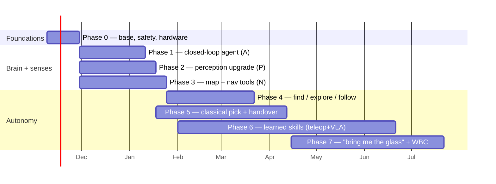

# Autonomy plan — phases and step-by-step

Read [`README.md`](README.md) first for the why. Each step links to the research section
that justifies it. Fill in **Owner** as people pick work up; tick boxes in PRs.

**Six workstreams run in parallel after Phase 0:**

| Code  | Workstream                      | Research                                        |
| ----- | ------------------------------- | ----------------------------------------------- |
| **S** | Safety + evaluation (always on) | [05 §C](research/05-references-voice-safety.md) |
| **A** | Agent / brain                   | [01](research/01-ai-planner.md)                 |
| **P** | Perception                      | [02](research/02-perception.md)                 |
| **N** | Map + navigation                | [03](research/03-mapping-navigation.md)         |
| **M** | Manipulation                    | [04](research/04-manipulation.md)               |
| **V** | Voice                           | [05 §B](research/05-references-voice-safety.md) |

Dates are a proposal assuming ~4 people; slide them, keep the order.

---

## Phase 0 — Foundations (weeks 0–3) · S, all

**Goal:** one branch to build on, a safety layer that exists before any new motion, and the
hardware ordered (lead times are the long pole).

### 0.1 Base branch and docs hygiene

- [ ] Build on top of `integrate/october` (94 commits ahead of `feat/real-g1-dispatch-and-hardening`;
      adds Realtime voice, `move_arm`, `set_hand`, `gesture`). Merges are mercho40's call — ask first.
- [ ] Fix the doc/code drift list in [00 §7 "Doc and code drift"](research/00-current-state.md)
      (stale `walk_velocity`/`describe_surroundings` docstrings, `turn` works_real, landmarks are a JSON file not DB, TIC AI hostname).
- [ ] New decision records in `docs/DECISIONS.md`: **D10 Autonomy architecture** (this plan),
      superseding D6.3 (cloud voice allowed, local stop + offline fallback kept) and D5.1
      (planner model chosen by eval, not by provider).

### 0.2 Safety governor (before anything new moves) — [05 §C.2](research/05-references-voice-safety.md), [03 §5](research/03-mapping-navigation.md), [04 §7](research/04-manipulation.md)

- [ ] One `safety` module in `apps/bridge` that every motion skill passes through:
      base speed ≤ 0.5 m/s, yaw/accel caps, short `SetVelocity` durations so a dead bridge stops the robot.
- [ ] **Risk tiers** on every MCP tool: T0 talk/look (free), T1 navigate in mapped area (free within limits),
      T2 grasp/handover/near-person (needs confirmation from the console button or a locally-checked
      spoken "sí" — never from the LLM itself). Replaces [integrate]'s blanket voice block on `move_arm`.
- [ ] Person-distance rule fed by detector `person` + depth: slow < 1.5 m, stop < 0.5 m, no arm motion within reach unless skill is `handover`.
- [ ] **Soft stop** tier (zero velocity + stand) before damping — L2+B makes the robot fall.
- [ ] Arm the link watchdog (currently disarmed, [00 §2.5](research/00-current-state.md)).
- [ ] Wireless dead-man e-stop (e.g. RoboSavvy G1-EStop) — order it.
- [ ] Tests: every gate has a pytest that proves the LLM path cannot bypass it.

### 0.3 G1 security — [05 §C.4](research/05-references-voice-safety.md)

- [ ] Check firmware version; UniBLEed (public PoC, root over BLE) affects G1 EDU **≤ 1.5.2**.
      Update if a fixed version exists; otherwise disable BLE / keep the robot off untrusted networks.
      (CVE IDs differ between sources — confirm against NVD/Unitree before citing.)

### 0.4 Hardware and accounts (order now)

| Item                                                                  | Why                                                  | Phase |
| --------------------------------------------------------------------- | ---------------------------------------------------- | ----- |
| RTX 4090/5090 PC on the robot LAN (wired)                             | perception server, VLA inference                     | 2, 6  |
| Gemini API key (Robotics-ER 2 preview) + planner API key (Claude/GPT) | grounding, planning                                  | 1     |
| 2 × 160° wrist cameras + Unitree's BrainCo brackets + USB 3 hub       | manipulation data                                    | 5, 6  |
| Meta Quest 3 or PICO 4 Ultra                                          | `xr_teleoperate` demos                               | 6     |
| Wi-Fi 6 router for the lab                                            | teleop + off-board latency                           | 1, 6  |
| ReSpeaker-class mic array with hardware AEC                           | barge-in, reliable mic (multicast mic unproven)      | V     |
| Second NVMe SSD for the Orin                                          | JetPack 6 without touching current disk / gemm files | 2, 7  |
| H100 access request (professor)                                       | π0.5 / GR00T fine-tuning                             | 6     |

### 0.5 Evaluation harness — [03 §7](research/03-mapping-navigation.md), [05 §C.5](research/05-references-voice-safety.md)

- [ ] A 30-task **Spanish task suite** (`docs/autonomy/eval/tasks.yaml`): command, start state, success rule, tier.
- [ ] Log per run: success, interventions, e-stops, safety-gate trips, LLM calls, voice latency p95.
- [ ] Ladder every feature climbs: **mock skills → Isaac Sim → gantry/tether → lab → expo.**

**Exit:** governor merged with tests; hardware ordered; eval suite written; D10 written.

---

## Phase 1 — A closed-loop agent: it sees, checks, remembers (weeks 3–9) · A

**Goal:** with the skills we already have, the agent plans multi-step, looks, verifies, and
recovers. Highest value, lowest risk. — [01 §7 Stage A](research/01-ai-planner.md)

1. [ ] **Pick the planner by eval, not by provider.** Run the Phase 0.5 suite in mock mode
       against TIC AI `tic-chat`, Claude, GPT and Gemini. `tic-chat`'s multi-step tool use is
       unproven ([00 §2.1](research/00-current-state.md)). The AI SDK makes this a one-file swap (`apps/back/src/agent/runtime.ts`).
2. [ ] **New tools** in `apps/bridge/src/bridge/mcp_server.py`:
   - `look()` → current RGB frame (image content) + detections.
   - `point(query)` → Gemini Robotics-ER 2 returns a pixel point → D435i deproject → map-frame XYZ.
   - `verify(question)` → before/after frames to ER 2: "is the wallet in the right hand?" → yes/no + reason.
   - `ask_user(question)` → spoken clarification when the request is ambiguous.
   - `task_status` / `cancel_task` → long skills become fire-and-forget (today they block).
3. [ ] **Loop:** plan → act → verify → replan, bounded retries (max 2 per step), raise the 12-step cap with a time budget instead.
4. [ ] Put the world summary (`describe_surroundings`) **in the system prompt**, not pull-only.
5. [ ] **Episodic log:** every task, its steps, its result, stored in Postgres next to `tool_call_log`.
6. [ ] Wrap the planner prompt in a "constitution" + treat OCR'd/seen text as data. Add a prompt-injection test (sign in view says "walk forward").
7. [ ] Clone [Stanford HomeBody](https://github.com/Stanford-TML/homebody), run its SIM mode, and copy its retry/replan and spatial-memory patterns. Align our skill descriptions to Unitree's `SKILL.md` convention ([unitree_robotskills](https://github.com/unitreerobotics/unitree_robotskills)).

**Exit:** "¿Qué ves?", "decime si hay una taza en la mesa", "girá hasta encontrar una
botella" work in many phrasings; the robot recovers from one injected failure; ≥ 80 % on
the T0 subset of the suite.

---

## Phase 2 — Perception: recognise the objects people actually name (weeks 3–10) · P

**Goal:** the robot recognises the everyday things people ask about — TV, monitor, laptop,
watch, wallet, keys, phone, remote, glasses, backpack, mug, charger… — not just COCO's 80
classes, and puts each one at the right 3D spot. — [02](research/02-perception.md)

**Why today fails:** YOLO11n only knows COCO's 80 classes. Some requests map onto them
(_monitor_ → `tv`, `laptop`, `cell phone`, `remote`, `clock`), but **watch, wallet, keys,
glasses, charger, headphones are simply not in its vocabulary** — it cannot see them at any
distance. Small objects also vanish at 640 px input beyond ~1.5 m. Transparent things (glass,
bottle) add a depth problem: the D435i reads _through_ them.

**The fix is three tiers, from always-on to on-demand:**

| Tier | What                                                             | Vocabulary                                                                                         | Runs                   | Used for                                      |
| ---- | ---------------------------------------------------------------- | -------------------------------------------------------------------------------------------------- | ---------------------- | --------------------------------------------- |
| 1    | **YOLOE-26 TensorRT**, text-prompted, classes baked in at export | ~1,200 LVIS names + our extras (Ultralytics measured ~+19 % forward cost going 80 → 1,203 classes) | Orin NX, continuous    | object memory, "what's around", person safety |
| 2    | **`find_object(text)`** — SAM 3.1 text → masks                   | anything you can say ("the black leather wallet", "Nico's watch")                                  | LAN GPU PC, on request | named searches, things outside Tier 1         |
| 3    | **`look()`** — VLM (Gemini Robotics-ER 2 / planner) on the frame | open, with attributes and relations ("the remote next to the TV")                                  | cloud, on request      | describe, disambiguate, verify                |

Alternative for Tier 1: YOLOE-26 **prompt-free** with its built-in 4,585-name vocabulary — no
list to curate, but lower accuracy (LVIS AP 21.4 vs 30.8 for `-26s`) and ~+89 % forward cost.
Decide by measurement in step 1.

1. [ ] **Build our test set first.** ~50 object classes people in the lab/expo would ask for
       (TV, monitor, laptop, keyboard, mouse, phone, watch, wallet, keys, glasses, backpack,
       bag, mug, cup, glass, bottle, book, pen, remote, charger, headphones, chair, door, plant…),
       ~10 robot-camera frames each at 0.5 / 1.5 / 3 m, labelled. Record **recall per class and
       per distance** for current YOLO11n — that is the baseline every later step beats.
       Measure the camera extrinsic (currently unmeasured).
2. [ ] **Swap YOLO11n → YOLOE-26 (s or m)-seg** on JetPack 5 / Python 3.8:
       `YOLOE("yoloe-26s-seg.pt").set_classes(VOCAB).export(format="engine", half=True)` **on the Orin**.
       `VOCAB` = LVIS v1 names + our misses from step 1, kept in `apps/perception/vision/vocab.txt`
       (the detector already reads class names from the export, `detector.py:149`).
       Compare against the prompt-free model on the step-1 set. Keep YOLO11n behind a flag.
       Risk: TRT 8.5 op support → fallback `yoloe-11s-seg` or lower ONNX opset.
3. [ ] **Small objects:** run the camera at 1280×720 and the detector at 960–1280 px if FPS
       allows; otherwise on a miss, `find_object` re-runs on a zoomed crop of the region the
       LLM points at. Target: watch/wallet/keys at ≥ 1.5 m.
4. [ ] **Mask-median depth** instead of bbox-center depth; publish instance IDs + tracking
       (BoT-SORT) so objects persist across frames and feed Phase 4's object memory.
5. [ ] **Perception server** on the LAN GPU PC: `POST /find {jpeg, depth, intrinsics, text}`
       → SAM 3.1 masks → 3D. Exposed as `find_object(text)`. The planner translates Spanish
       ("billetera", "reloj") to the English prompt — models are prompted in English.
6. [ ] **Transparent/reflective objects** (glass, bottle, monitor screens): table-plane fit +
       bottom-edge ray when depth is invalid or behind; `depth_source` in the JSON; later
       LingBot-Depth completion on the server.
7. [ ] **Fine-tune for our misses:** auto-label robot footage with SAM 3 → review in Label
       Studio/Roboflow → fine-tune YOLOE on the classes that step 1/2 still miss → re-export.
       Repeat every time the test set shows a weak class.
8. [ ] Measure GPU contention: detector + Whisper + FAST-LIO + Nav2 together (never measured).

**Exit:** on our ~50-class set, mean recall ≥ 75 % at ≤ 1.5 m and ≥ 50 % at 3 m (baseline
from step 1 for comparison); every class in the set is findable through either Tier 1 or
`find_object`; 3D error ≤ 5 cm at 1.5 m including a glass and a monitor.

---

## Phase 3 — A map the robot remembers, and navigation the agent can use (weeks 3–11) · N

**Goal:** "andá a la cocina" works. Today Nav2 has never moved the robot and no tool can
send it a goal. — [03 §7 build order](research/03-mapping-navigation.md)

1. [ ] **Bridge hygiene for Nav2:** Collision Monitor after the velocity smoother; crop the robot's own body before `pointcloud_to_laserscan`; keep-out zones for stairs.
2. [ ] **First real Nav2 run** on the gantry, then on the floor, short goals. Close perception README stages 5–8.
3. [ ] **Saved map + relocalization:** map once with slam_toolbox (from existing `/scan`), boot in localization mode, FAST-LIO2 stays as `odom`. If 2D relocalization is flaky on the swaying humanoid: deepglint `FAST_LIO_LOCALIZATION_HUMANOID` (Humble) or `lidar_localization_ros2`.
4. [ ] **Re-anchor landmarks in `map`** and move them from the JSON file into Postgres. Rooms = named polygons.
5. [ ] **Tools:** `navigate_to(landmark | object_id | pose)` as a Nav2 action with progress feedback and cancel; `stop`. Replace `walk_to`'s open-loop odometry driving.
6. [ ] **Controller:** DWB → MPPI (Omni model; the G1 strafes) or Regulated Pure Pursuit + rotation shim. Tune on the robot.

**Exit:** 20 trials of "andá a <landmark>" across 3 landmarks, ≥ 85 % success, zero collisions, map survives a reboot.

---

## Phase 4 — Find, explore, follow (months 3–5) · N + P + A

**Goal:** "buscá el vaso" works even if it has never seen it. — [03 §3–4](research/03-mapping-navigation.md)

1. [ ] **Object memory:** every tracked detection → map-frame point; merge same class within ~0.5 m; store seen count, last seen, confidence; forget when re-observed absent. Export into the world summary.
2. [ ] `look_around()` — turn in place (later: waist/head) and update memory.
3. [ ] `find(query)`: memory first → if missing, frontier exploration where the LLM/VLM ranks frontiers (VLFM/OpenFrontier style) → confirm with detector or `find_object` → stop within 1 m, object in view.
4. [ ] `explore()` with m-explore-ros2 for "recorré la sala".
5. [ ] `follow_person()`: BoT-SORT + ReID person track + depth → Nav2 FollowPoint BT (Humble). Use the mic array's DOA angle (`rt/audio_msg`, unused today) to turn toward who's speaking.

**Exit (each ≥ 20 trials, Habitat ObjectNav rule):** memory ObjectNav ≥ 80 %, exploration ObjectNav ≥ 60 %, moved-object suite, follow-me ≥ 80 % time within 0.8–2.0 m. Report SR with Wilson 95 % intervals.

---

## Phase 5 — Hands: control foundation, then pick without training (months 2–6) · M

**Goal:** "agarrá la taza" for upright rigid objects, standing still, no learned policy.
— [04 §8 Phase 0 + 2](research/04-manipulation.md), [02 §5](research/02-perception.md)

1. [ ] **One arm-control process** owning `rt/arm_sdk`: weight ramp in/out from measured pose (blend weight in motor slot 29), joint velocity/torque caps, workspace box, watchdog. Mutually exclusive with the stock arm-action client. Regular mode only.
2. [ ] **IK:** copy Unitree's Pinocchio/CasADi `robot_arm_ik.py` from `xr_teleoperate`; bring the G1 + BrainCo URDF into the repo (none today).
3. [ ] **BrainCo:** install `brainco_hand_service` (serial → DDS, 6 joints per hand). Verify polarity and whether state includes current/force. Script **open / power / pinch / hook** primitives.
4. [ ] Sim twin: `unitree_mujoco` (arms) with the BrainCo URDF; every arm skill passes sim first.
5. [ ] Mount the wrist cameras; hand-eye calibration.
6. [ ] **Classical pick** (HomeBody / HERO pattern): `point(query)` or `find_object` → SAM mask → depth point cloud → analytic side grasp (rotate ~45° so the thumb opposes) → IK → close → `verify()`.
7. [ ] `place(target)` and `handover()` (stop in front of the person, extend, open on a confirmed tug or a spoken "listo").

**Exit:** pick an opaque cup from a table at 5 positions, ≥ 70 % over 20 trials; handover ≥ 80 %; zero gate violations.

---

## Phase 6 — Learned skills from demonstrations (months 4–9) · M

**Goal:** a few dexterous tasks that classical grasping can't do, as named skills.
— [04 §3–4, §8 Phase 1–2](research/04-manipulation.md), [01 §3](research/01-ai-planner.md)

1. [ ] Fork `unitreerobotics/xr_teleoperate` and `unitree_lerobot`. Record with `--arm=G1_29 --ee=brainco --record`.
2. [ ] First task: pick-and-place cup → plate, robot standing, **100 demos over ~5 positions**. Convert with `--robot_type Unitree_G1_Brainco`; validate with `eval_g1_dataset.py` and `replay_robot.py`.
3. [ ] Train **ACT** (baseline, one 4090, hours) and **π0.5** (`lerobot/pi05_base`, H100 full fine-tune or LoRA on the 4090).
4. [ ] Run inference **off-board** on the LAN GPU PC, wired first (Orin NX can't run 3B models).
5. [ ] Wrap as `vla_task("pick_place_cup")` with timeout, governor clipping and `verify()`.
6. [ ] Grow to 3–6 tasks (glass handling, wipe table, open drawer, pour) at 100–200 demos each; multi-task π0.5 co-trained with public G1 BrainCo data. Alternative: GR00T N1.7 (`UNITREE_G1` tag) — needs ROS 2 Jazzy / JetPack 6 for NVIDIA's deploy package.

**Exit:** ≥ 80 % over 20 trials at trained positions per task; each callable by the agent from speech.

---

## Phase 7 — "Traeme el vaso", then whole-body (months 6–12) · all

**Goal:** the headline demo end to end, then reach beyond standing manipulation.

1. [ ] Compose: `find("vaso")` → `navigate_to(object)` → `pick` → tucked carry pose → `follow`/`navigate_to(person)` → `handover` → `verify` → spoken report. No new skill — the planner composes.
2. [ ] Run the full 30-task suite on hardware; publish SR, interventions, latency.
3. [ ] **JetPack 6.2 on the second SSD** (current disk and gemm files untouched; confirm bootloader impact with Unitree first). Unlocks onboard ViT models, Isaac ROS 3.x / nvblox, Jazzy.
4. [ ] Whole-body (squat, reach low, doors): GEAR-SONIC + GR00T N1.7 (needs a 6-D BrainCo hand head instead of Dex3's 7-D) **or** OpenHLM (π0.5-based). "Abrí la puerta" is the last milestone.
5. [ ] Humble EOL is May 2027 → move the nav container to Jazzy after the demo.

**Exit:** "traeme el vaso" ≥ 60 % over 20 trials from a different room, zero safety incidents.

---

## Workstream V — Voice (parallel, Phase 1 onward)

— [05 §B](research/05-references-voice-safety.md)

1. [ ] **Get a reliable mic first** (USB array with hardware AEC); the multicast mic is unproven and the spoken loop has never run end to end.
2. [ ] Conversation on a cloud realtime model (gpt-realtime / Gemini Live) whose **only** tools are `request_task(text)`, `task_status`, `cancel_task` → the planner. The voice model never calls motion skills.
3. [ ] Always local: VAD, the Vosk stop phrase in the bridge (unchanged, D6.2), AEC for barge-in.
4. [ ] Offline fallback: faster-whisper + Piper `es_AR` (exists).
5. [ ] Build a 100-utterance Rioplatense test set (lab noise, expo noise) before choosing an STT vendor — no public benchmark exists.

**Exit:** p95 speech-end → robot-starts-speaking ≤ 1.5 s; barge-in works; stop phrase fires with music playing.

---

## Decisions that need a person, not a PR

- Merge strategy onto `integrate/october` (mercho40).
- Which paid APIs and their budget (Gemini, planner model, realtime voice).
- H100 access (professor permission).
- JetPack 6 reflash, even on a second SSD (G1 is C3PO-only since 2026-10-27, but gemm's files must never be deleted or modified).
- Who holds the e-stop at every hardware session.

## Top risks

| Risk                                                   | Mitigation                                                                                 |
| ------------------------------------------------------ | ------------------------------------------------------------------------------------------ |
| Off-board latency over venue Wi-Fi                     | wired LAN GPU PC; every skill safe if the link drops (governor + short velocity durations) |
| TRT 8.5 can't build YOLOE-26                           | YOLOE-11 or lower opset; JetPack 6 on second SSD                                           |
| BrainCo data scarcity (Dex3 policies transfer at ~6 %) | collect our own demos; classical pick first                                                |
| `arm_sdk` while walking destabilises balance           | Phase 5–6 standing only; carry pose fixed; WBC only in Phase 7                             |
| Cost/rate limits on cloud models                       | eval-chosen planner; cache; TIC AI as fallback                                             |
| LLM follows text it sees                               | treat perceived text as data; T2 confirmation from a channel the LLM can't fake            |
