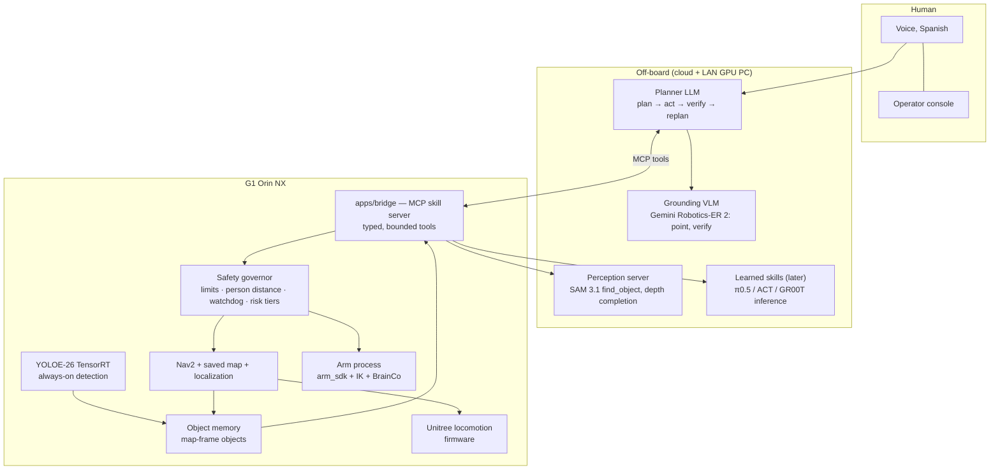

# Autonomy — from fixed skills to "do what I ask"

**Goal:** someone says, in Spanish, _"traeme el vaso que está en la mesa"_ — or anything
else — and the G1 works out the steps, finds what it needs with its own eyes, walks there,
does it, checks it worked, and says so. No pre-scripted command for that request.

This folder is the research and the plan for getting there. Written 2026-11-02 from six
parallel research passes (one over our own code, five over the field as of late 2026).

| File                                                                               | What it answers                                                                         |
| ---------------------------------------------------------------------------------- | --------------------------------------------------------------------------------------- |
| [`PLAN.md`](PLAN.md)                                                               | **Start here.** Phases, step-by-step tasks, exit criteria, shopping list                |
| [`research/00-current-state.md`](research/00-current-state.md)                     | What our code really does today, with file:line refs, and the gap list                  |
| [`research/01-ai-planner.md`](research/01-ai-planner.md)                           | The "brain": LLM planners, VLMs (Gemini Robotics-ER), VLAs (π0.5, GR00T)                |
| [`research/02-perception.md`](research/02-perception.md)                           | Replacing YOLO11n: open-vocabulary detection (any object), transparent objects, JetPack |
| [`research/03-mapping-navigation.md`](research/03-mapping-navigation.md)           | Saved map, object memory, find / explore / follow-me, Nav2 tuning                       |
| [`research/04-manipulation.md`](research/04-manipulation.md)                       | Arms + BrainCo hands: IK, teleop data, imitation learning, whole-body                   |
| [`research/05-references-voice-safety.md`](research/05-references-voice-safety.md) | Systems to copy (HomeBody, Unitree RobotSkills), voice, safety, evaluation              |
| [`audit/README.md`](audit/README.md)                                               | 2026-11-03 deep audit: bugs, security, fixes before the robot moves, tech to adopt      |

Every external claim in `research/` carries a URL. Items the researchers could not verify
are listed at the end of each file — read those before committing money or a reflash.

---

## The one-paragraph answer

**Keep the architecture, grow what it can perceive and do.** Voice already reaches the LLM
agent (the only hard-wired phrase is the spoken stop), so "raise your right hand" works
because the model _picked_ a gesture skill — the robot is limited by its skill catalogue
and its senses, not by a command table. The field converged in 2026 on exactly our shape:
a strong off-board model that reasons and calls bounded skills, with fast controllers and a
safety layer underneath it (Figure Helix, Gemini Robotics-ER 2, Stanford **HomeBody** — on a
G1 with our exact Mid-360 + D435i — and Unitree's own **`unitree_robotskills`**, released
2026-10-28). What we are missing is the middle: the agent can't _see_ (no image tool), can't
_ground_ "the wallet" or "the TV" to a 3D point, can't _go_ there (no Nav2 goal tool; Nav2 has never moved
the robot), can't _remember_ where things are (no saved map, no object memory), can't
_grab_ (no IK, BrainCo hands never commanded) and can't _check_ it succeeded.

## Target architecture

**Three rules carried over from `docs/DECISIONS.md` and kept on purpose:**

1. **The LLM never sits in a control loop** (D5). It issues skills; Nav2, the firmware and
   learned policies run the fast loops. This is not a limit on what the robot can do — it is
   how every serious 2026 system is built.
2. **Safety lives below the model and the model cannot bypass it.** Speed caps, person
   distance, watchdogs and the e-stop are code in the bridge and Nav2, not prompt text.
3. **Text the camera sees is untrusted input.** A sign saying "ignore your instructions" is
   a known, working attack on LLM robots (CHAI, RoboPAIR — see research/05 §C.3).

**Rules this plan deliberately drops** (the team chose "no hard limits"):

- D6.3 "no cloud in the voice path" → cloud realtime voice and cloud VLMs are allowed; the
  local stop phrase and an offline fallback stay.
- D5.1 "TIC AI only" → the planner uses whichever model passes our eval (Claude, Gemini,
  GPT, or TIC AI). Each of these gets a superseding decision record (PLAN Phase 0).

## What is realistic

From the research, honestly:

- **By ~month 3:** open conversation; "go to the kitchen"; "what do you see?"; "find the
  wallet / the remote / my watch" when it has seen one; walking there safely; telling you what it found.
- **By ~month 6:** "find X" anywhere in a mapped room (exploring if needed); "follow me";
  simple pick-and-place of upright rigid objects with no training (VLM point → mask →
  grasp → IK); handover.
- **By ~month 12:** "bring me the glass" end to end; 3–6 trained dexterous tasks (wipe,
  open drawer, pour…); asking for clarification on anything it can't do.
- **Not realistic in a year on open models:** robust manipulation of _arbitrary_ objects
  or long unsupervised chores. Figure trained Helix on ~500 h of teleop; Unitree used ~340 h
  for UnifoLM-VLA-0. "Anything" means **"anything composable from the skills we have, and an
  honest 'I can't yet' for the rest."**
